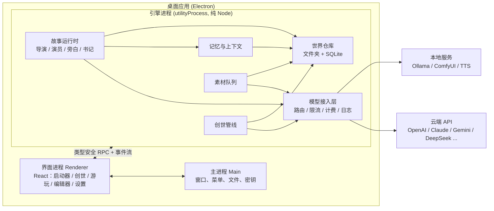
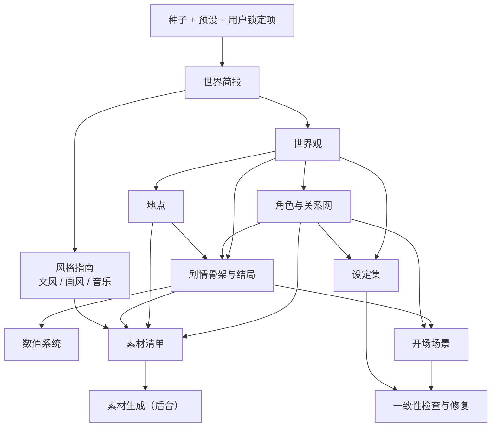
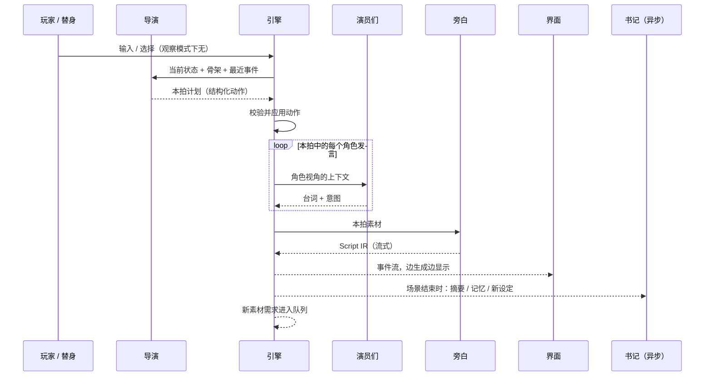

# Auto-ADV 架构设计（v0.3）

> 状态：主体方向已确认（见下方"已确认的决定"），细节仍可调整。
> 路线图见 [ROADMAP.md](./ROADMAP.md)。

## 已确认的决定（2026-11-19）

| 项 | 决定 |
|---|---|
| 技术栈 | Electron + TypeScript 全栈（第 3 节） |
| 首发平台 | **Windows**；macOS / Linux 之后再做 |
| 优先接入的模型 | **OpenAI 兼容格式**；先把这一种接口做扎实，提示词也先针对它调；Anthropic、Gemini 原生接口后续按需加入 |

## 0. 一句话定位

Auto-ADV 是一个桌面端的 **AI 视觉小说引擎 + 播放器**：一键生成一个完整的世界（世界观、角色、设定集、剧情、立绘、背景、BGM……），然后你可以和角色自由聊天、按 ADV 的方式带分支地游玩，或者干脆只当观众，看 AI 角色们自己把故事一直演下去。

## 1. 需求回顾

| # | 需求 | 结论 |
|---|---|---|
| 1 | 形态 | 桌面应用 |
| 2 | 一键创建世界 | 像 Minecraft 新建世界：默认全自动；"更多选项"里方方面面都可以自定义，但都是可选的 |
| 3 | 游玩模式 | 自由对话（类 SillyTavern）、剧情 ADV（分支 / 存档 / 数值）、**观察模式**（AI 之间持续自主演出，无需人工干预，这是 "Auto" 的核心） |
| 4 | 数据格式 | 以自有原生格式为核心；SillyTavern 角色卡 / 世界书导入是锦上添花 |
| 5 | 模型 | 文本模型（OpenAI 兼容、Claude、本地 Ollama 等）全都支持，**OpenAI 兼容格式优先**；生图、生视频按需接入 |
| 7 | 平台 | **Windows 首发** |
| 6 | 同人模式 | 从已有作品学习，生成衍生世界 |

## 2. 设计原则

1. **默认全自动，处处可接管。** 任何生成出来的东西（一个角色、一条设定、一句台词、一张立绘）都可以锁定、手改或重抽。
2. **一个引擎，三种模式。** 自由对话、剧情 ADV、观察模式共用同一个故事运行时和同一条事件时间线，区别只是"谁坐在哪个席位上"和"怎么呈现"。所以可以中途切换：看一会儿 AI 演，随时接管主角自己玩。
3. **只有一个文本模型也能完整游玩。** 图片、音乐、语音、视频都是增强层，缺了就用占位图 / 纯文本降级，绝不阻塞游玩。
4. **LLM 提议，引擎裁决。** 模型输出结构化的"动作"（改数值、换场景、揭示秘密……），由确定性的引擎校验后才写入状态，防止数值和设定被模型改乱。
5. **格式开放可读。** 一个世界就是一个文件夹（JSON / Markdown + 素材），可以手改、可以用 git 管理、可以打包分享。
6. **成本看得见、管得住。** 观察模式会无人值守地一直跑，所以从第一天起就要有预算上限、按职责分配强弱模型、尽量命中提示词缓存。
7. **引擎与界面分离。** 核心引擎是不依赖 Electron 的纯 TypeScript 包，可以用命令行无界面运行，方便自动化测试和批量评估生成质量。

## 3. 技术栈推荐

### 3.1 结论

| 层 | 选型 | 理由 |
|---|---|---|
| 桌面壳 | **Electron** | 见 3.2 |
| 语言 | **TypeScript 全栈** | 前端、引擎、工具链一种语言；LLM 应用生态第一梯队 |
| 工程结构 | pnpm workspace monorepo + electron-vite | 引擎、模型层、格式定义拆成独立包，界面只是其中一个使用者 |
| 界面 | React + Tailwind CSS | 生态成熟。M0 先用自己写的少量基础组件；创世选项、编辑器等表单变多后再引入 shadcn/ui，跨页面状态变复杂时再上 Zustand |
| VN 舞台 | 先用 DOM/CSS + Motion 动画；需要粒子、着色器、Live2D 时换 PixiJS | 先快后强；舞台接口抽象好，渲染层可替换 |
| 音频 | Web Audio（Howler.js） | BGM 淡入淡出、音效、语音分轨混音 |
| 模型接入 | 自己的 Provider 接口；OpenAI 兼容适配器直接基于 fetch 手写 | 各家"兼容"接口有很多小差异（DeepSeek 的 `reasoning_content`、有的不认 `stream_options`、推理模型要 `max_completion_tokens`），自己写才能完整记录原始请求响应、逐项探测和自动修正。以后接 Anthropic / Gemini 原生接口时再按需选官方 SDK 或 AI SDK，放在同一个接口后面 |
| 数据定义 | Zod | 同一份 schema 同时用于：原生格式校验、LLM 结构化输出、进程间通信的类型 |
| 存储 | 世界定义用文件夹（JSON / MD）；运行数据用 SQLite（Node / Electron 自带的 `node:sqlite`）；向量检索用 sqlite-vec 扩展 | 不需要额外数据库服务，单文件，可以随世界一起打包；内置模块不用编译原生代码，Windows 上打包省掉一大类问题 |
| 密钥 | Electron safeStorage（系统钥匙串加密） | API Key 不明文落盘，也绝不写进世界包 |
| 测试 | Vitest + LLM 调用录制回放 | 引擎测试可重复、不花钱 |

### 3.2 为什么是 Electron，而不是 Tauri 或 Python

| | Electron + TS | Tauri + Rust | Python 后端 + Web 前端 |
|---|---|---|---|
| 安装包体积 | 大（约 100MB 起） | 小（约 10MB） | 大，而且打包很痛苦 |
| AI 应用生态 | 好：各家官方 SDK、AI SDK | 弱：大部分要自己写 | 最好（尤其是本地模型） |
| 长时间后台任务 | Node 子进程，随意 | 要么用 Rust 写，要么再挂一个 sidecar | 好 |
| 开发效率 | 一种语言打通前后端 | 两种语言 | 两种语言 + 打包痛点 |

核心理由：这个项目的复杂度几乎全在 **Agent 编排、提示词和数据** 上，而不在原生性能上。TypeScript 在 LLM 应用生态里是第一梯队，前后端一种语言能把迭代速度拉到最大。体积大不是问题，一个世界生成的素材本身就有几百 MB。

本地的重型模型（Stable Diffusion / Flux、TTS、音乐生成）**不嵌入应用**，而是通过 HTTP 接到 ComfyUI、Ollama、本地 TTS 服务等外部程序。这样应用里不需要 Python 运行时，也不用操心显卡驱动。

如果将来确实在意体积，引擎核心是纯 TS 包，换成 Tauri 壳 + Node sidecar 的成本是可控的。

### 3.3 不用重型 Agent 框架

LangChain / LangGraph 这类通用框架抽象层厚，而我们的循环是领域特定的（导演 / 演员 / 书记），需要精细控制上下文怎么拼、缓存怎么命中、钱怎么花。所以自己写一层薄的编排，模型适配也自己掌控（见 9.2）。

## 4. 总体架构



**进程模型**

- **界面进程**：只负责显示和交互，不直接调用模型。
- **主进程**：窗口、菜单、文件对话框、密钥加解密。
- **引擎进程**：所有生成、游戏循环、数据库读写都在这里，用 Electron 的 `utilityProcess` 跑。好处是观察模式长时间运行也不会卡界面；同一份引擎代码也能被命令行工具直接加载。
- 界面与引擎之间用类型安全的 RPC 通信，并支持流式订阅（台词逐字出现、素材生成进度）。主进程只负责把一条 MessagePort 交给双方，之后界面和引擎直接通信。
- 引擎联网用 Electron 的 `net.fetch`（Chromium 网络栈），自动遵循系统代理设置，开着代理软件就能访问海外模型服务。

**代码组织**

```
auto-adv/
├─ apps/
│  ├─ desktop/        Electron 应用（main / preload / renderer）
│  └─ cli/            无界面运行器：生成世界、跑观察模式、回放、质量评估
├─ packages/
│  ├─ schema/         原生格式（Zod 定义）与版本迁移
│  ├─ providers/      模型接入层：文本 / 嵌入 / 图像 / 视频 / 音乐 / 语音
│  ├─ engine/         核心：世界仓库、创世管线、故事运行时、记忆、素材队列
│  ├─ compat/         SillyTavern 等外部格式的导入导出
│  └─ player/         VN 舞台与聊天界面的 React 组件
└─ docs/
```

依赖方向是单向的：`schema` ← `providers` ← `engine` ← `apps/*`；`compat` 只依赖 `schema`，核心不依赖它。

目前（M2）已有 `schema`、`providers`、`engine`、`desktop`、`cli`；`compat` 和 `player` 在用到时加入。各包直接导出 TypeScript 源码，桌面端由 electron-vite 打包，命令行工具由 Node 直接运行（Node 22.18+ 原生支持 TypeScript）。

## 5. 原生格式：世界包

### 5.1 世界与周目

- **世界（World）**：设定本身，包括世界观、角色、地点、设定集、剧情骨架和素材。可分享、可复用，相当于"地图模板"。
- **周目（Playthrough）**：某一次游玩的运行状态，包括事件日志、变量、角色记忆，以及游戏过程中新诞生的内容。一个世界可以有多个周目。
- 游戏中新长出来的角色、地点、设定，先写进周目的"覆盖层"，可以一键"提升"回世界本体，让世界越玩越丰富。

### 5.2 目录结构

```
my-world/                        一个世界 = 一个文件夹；导出时打包成 .advworld（zip）
├─ world.json                    清单：id、标题、格式版本、创世配置与种子、所用模型
├─ brief.json                    世界简报：题材、基调、时代、主题、分级、目标篇幅
├─ setting/
│  ├─ worldview.md               世界观正文
│  └─ lore/*.json                设定集条目
├─ characters/<id>/character.json
├─ locations/<id>.json
├─ plot/
│  ├─ outline.json               剧情图：章 / 幕 / 出口 / 结局 / 伏笔（M3 起，见 16.2）
│  └─ scenes/*.adv               （可选）手写或固化下来的剧本
├─ systems/variables.json        数值与标记定义（好感度、金钱、日期……）
├─ style/style.json              文风、画风、音乐风格指南
├─ assets/                       图片、音乐、音效、语音、视频
│  └─ index.json                 素材登记：用途、提示词、模型、种子、来源
└─ playthroughs/
   └─ play.db                    SQLite：事件日志、快照、记忆、向量索引、存档位（分享时默认不含）
```

### 5.3 核心实体（示例）

**角色**

```jsonc
{
  "id": "char_lin",
  "name": "林夕",
  "aliases": ["小夕"],
  "role": "heroine",                       // protagonist / heroine / rival / npc ...
  "summary": "图书馆的常客，总在找一本不存在的书。",
  "appearance": {
    "text": "黑色长发，灰色眼睛，常穿旧式校服",
    "imagePrompt": "1girl, long black hair, grey eyes, old-fashioned school uniform",
    "referenceImage": "assets/char_lin/ref.png"
  },
  "personality": { "traits": ["外冷内热", "嘴硬"], "values": ["诚实"], "fears": ["被遗忘"] },
  "speech": { "style": "句子短，常用反问", "examples": ["……你管得着吗？"] },
  "background": "……",
  "goals": [{ "text": "找到失踪的姐姐", "priority": 1, "public": false }],
  "secrets": [{ "id": "sec_lin_1", "text": "……", "knownBy": ["char_lin"] }],
  "relationships": [{ "to": "char_mc", "type": "青梅竹马", "affinity": 40 }],
  "expressions": ["neutral", "smile", "angry", "sad", "blush", "surprised"],
  "voice": { "provider": "tts_local", "voiceId": "lin_v1" },
  "_meta": { "locked": ["name", "appearance.text"], "generatedBy": "step:cast" }
}
```

`_meta.locked` 记录用户锁定的字段：重抽时这些字段不会被覆盖，而且会作为约束传给生成器。`secrets[].knownBy` 是信息不对称的基础（见 7.2）。

**设定集条目**

```jsonc
{
  "id": "lore_aether_tide",
  "title": "以太潮汐",
  "content": "每隔七年，城市上空的以太会退潮……",
  "category": "magic",
  "keys": ["以太", "潮汐", "退潮"],
  "activation": "keyword",                 // always / keyword / semantic
  "scope": "global",                       // global / character:<id> / location:<id>
  "priority": 50,
  "knownBy": "public"                      // public 或角色 id 列表
}
```

触发字段有意和 SillyTavern 世界书对齐，导入时能尽量无损映射。

**剧情图**（M3 起代替 M2 的"篇章 / 章节 / 节拍"骨架，完整定义见 16.2）

```jsonc
{
  "premise": "……",
  "control": "guided",                     // sandbox 沙盒 / guided 引导 / linear 线性
  "start": "sc_01",
  "chapters": [{ "id": "ch_01", "title": "退潮之夜" }],
  "scenes": [{
    "id": "sc_01", "chapter": "ch_01", "title": "图书馆的偶遇",
    "what": "主角在图书馆遇到林夕，她在找一本不存在的书",
    "points": [{ "id": "sc_01_1", "text": "林夕提到失踪的姐姐" }],
    "done": "林夕答应带主角去旧书库",
    "minBeats": 2, "maxBeats": 6,
    "exits": [
      { "to": "sc_02", "label": "一起去旧书库", "when": "主角答应帮忙" },
      { "to": "sc_07", "label": "独自离开", "when": "主角拒绝", "if": { "lt": ["affinity.char_lin", 20] } }
    ],
    "default": "sc_02"
  }, {
    "id": "sc_12", "title": "潮汐归来", "what": "……",
    "ending": { "kind": "good", "text": "姐弟重逢，以太重新涨潮" }
  }],
  "threads": [{ "id": "fs_1", "text": "那本不存在的书", "plant": "sc_01", "payoff": "sc_09" }]
}
```

剧情图是"骨架"而不是"剧本"：每一幕只写要发生什么和怎样算演完，具体怎么演由导演和演员临场决定。`control` 决定导演的自由度，从完全沙盒到严格线性。换幕由引擎按出口和条件判断（16.2、16.3），结局是一种特殊的幕。

### 5.4 剧本中间表示（Script IR）

所有画面和声音的表现都走统一的指令流。AI 生成的内容和手写的剧本都编译成这一种格式，播放器只认它。所以可以手写开场，后面交给 AI。

手写用的文本形式（存储时是等价的 JSON）：

```
bg library_evening fade
bgm calm_daily
show lin neutral left
lin "……你也来找那本书？"
narrate "夕阳把书架的影子拉得很长。"
choice
  "我是来找你的" -> set affinity.char_lin +5
  "随便看看"
```

指令集初版：`bg` `show` `hide` `say` `narrate` `think` `bgm` `sfx` `voice` `cg` `video` `effect` `choice` `set` `jump` `wait`。

剧情图里的一幕可以挂一个手写的 `.adv` 文件（`plot/scenes/<幕 id>.adv`），演到这一幕时先播手写内容，再交给 AI。`jump` 和选项后面的 `-> goto <幕 id>` 只能指向这一幕声明过的出口，和 AI 走的是同一条换幕规则（16.2）。

### 5.5 版本与迁移

每个文件带 `formatVersion`；`packages/schema` 里维护逐版本的迁移函数；读到不认识的字段原样保留，不丢数据。

## 6. 一键创世：世界生成管线

### 6.1 交互（Minecraft 式）

"新建世界"页面只有几项：

- **世界名**：可留空，自动起名
- **种子**：一句话灵感，可留空（随机）
- **预设**：校园恋爱 / 奇幻冒险 / 悬疑推理 / 克苏鲁 / 赛博朋克 / 武侠修仙 / 随机……
- **模式**：自由对话 / 剧情 ADV / 观察
- **［创建］**　**［更多世界选项…］**

"更多世界选项"里展开每一步的设置：角色数量、是否自定义主角、篇幅、分级、画风、是否生成立绘 / BGM / 语音 / 视频、每一步用哪个模型等。任何一项都可以填具体内容（相当于锁定），也可以留给 AI。

三种创建方式：

- **一键**：全自动，直接开玩
- **向导**：每个阶段停下来给你看，可以改、可以重抽
- **手动**：直接进编辑器从零写

### 6.2 管线是一张依赖图



每个节点都有：

- **输入**：上游节点产物 + 用户锁定的字段 + 预设
- **输出**：经 Zod schema 校验的结构化数据
- **生成器**：提示词模板 + 指定的模型职责
- **校验与修复**：不合 schema 时把错误反馈给模型自动重试
- **状态**：待生成 / 生成中 / 完成 / 过期 / 锁定

### 6.3 锁定与重抽（像构建系统一样）

改了上游，下游自动标记为"过期"，你可以选择自动重算或保留现状。锁定的内容永远不会被覆盖。任意节点、任意实体、任意字段都可以单独重抽。

### 6.4 渐进式：先能玩，素材后到

文本部分（简报到开场）优先完成，通常几分钟内就能开始游玩。素材进入后台队列，按"马上要用"排优先级（开场场景的背景和立绘最先），没生成好的先用占位图，生成完自动替换。

### 6.5 成本预估

创建之前估算 token 数和图片 / 音频数量，按价格表给出预计费用。价格表可以自己维护。

## 7. 故事运行时（核心）

### 7.1 事件溯源：所有模式共用一条时间线

游戏里发生的一切都是一条**事件**：旁白、台词、动作、换场景、舞台指令、出现选项、做出选择、玩家输入、变量变化、写入记忆、时间推进、新实体诞生……当前状态 = 把事件从头折叠一遍（每隔 N 条存一次快照，读档很快）。

事件之间是一棵树，而不是一条链，这带来了：

- **存档** = 指向树上某个节点的指针，几乎零成本，存档数量不限
- **分支** = 树分叉；可以回到任意一点重来，或者重抽某一句话（类似 SillyTavern 的 swipe）
- **回放** 与 **导出**成小说 / 剧本
- **模式切换**：观察模式看一会儿，随时接管主角
- **调试**：每条事件都能追溯到产生它的那次模型调用

### 7.2 职责分工（多 Agent）

| 职责 | 做什么 | 能看到什么 | 推荐模型 |
|---|---|---|---|
| **导演** Director | 读剧情骨架和当前状态，决定下一拍发生什么：节奏、谁登场、是否给选项、何时收场；控制紧张度曲线；防跑题、防卡死 | 全知 | 强模型 |
| **演员** Actor（每个出场角色一个） | 以角色身份说话、行动，追求自己的目标 | **只有这个角色知道的信息** | 中等 / 便宜 / 本地 |
| **旁白** Narrator | 把一拍写成符合文风的叙述，并给出舞台指令（背景、表情、BGM 情绪） | 当前场景 | 中等 |
| **书记** Archivist | 场景结束后写摘要、更新角色记忆与关系、把新事实沉淀进设定集、发现需要新素材的新实体 | 全知 | 便宜 |
| **替身** Proxy | 观察模式下扮演主角 | 主角视角 | 中等 |
| **审校** Critic（可选） | 检查设定矛盾、角色 OOC | 全知 | 便宜，可关闭 |

演员只能看到自己知道的东西，这一点很关键：秘密、误会、"观众知道而角色不知道"的戏剧性反讽，只有在信息不对称时才演得出来。

两种运行策略，按世界或按周目切换：

- **合并模式**（省钱、适合本地小模型）：一次调用产出整拍，所有角色一起写，类似 SillyTavern 群聊
- **分演模式**（高质量）：导演和各个演员分开调用

### 7.3 一拍的循环



### 7.4 LLM 提议，引擎裁决

导演和演员输出带类型的动作，例如：

```json
{ "type": "set_var", "var": "affinity.char_lin", "op": "+", "value": 5, "reason": "主角记得她的生日" }
```

其他动作：`move_character` `advance_time` `start_scene` `offer_choice` `reveal_secret` `end_chapter` `request_asset` 等。

引擎逐条校验（变量范围和每拍变化上限、角色是否存在和在场、秘密能否揭示、出口条件是否满足），合法的才应用，不合法的带着理由反馈给模型。需要掷骰的行动由引擎掷骰并决定成败，模型只负责把结果写出来（16.4）。实现上：支持工具调用的模型用工具调用；否则用 JSON 结构化输出；对结构化输出不稳的本地小模型，退化为带标签的文本格式解析 + 自动修复重试。

### 7.5 三种模式 = 同一引擎的三种配置

| | 自由对话 | 剧情 ADV | 观察模式 |
|---|---|---|---|
| 主角席位 | 玩家（自由输入） | 玩家（选项 + 可选的自由输入） | AI 替身，或无主角群像 |
| 导演力度 | 弱：以回应为主 | 强：按剧情图推进，在岔路给选项 | 强：持续推进，剧情图走完自动续写新章节 |
| 呈现方式 | 聊天气泡（可带立绘和背景） | VN 舞台：背景 / 立绘 / 文本框 / 回想 / 自动 / 快进 | VN 舞台或小说流 |
| 推进方式 | 等玩家输入 | 等玩家点击或选择 | 自动 |

存档、分支、重抽三种模式通用。

### 7.6 观察模式细节（Auto 的核心）

- **生成与播放解耦**：后台预生成，前台按阅读速度播放；缓冲领先 N 拍就暂停生成，不看就不花钱。
- **观众工具**：暂停、倍速、跟随某个角色的视角（只看到 TA 知道的事）、上帝视角、**导演指令**（"让暴风雨来临""给林夕一点勇气"）、**悄悄话**（只对某个角色的内心说话）、随时接管任意角色、书签。
- **无限续写**：剧情图走完后（到了结局，或者没有出口可走），导演根据现状续写新的一章（新冲突、新角色），世界持续演化。
- **防崩坏**：重复检测（最近几拍的文本 / 语义相似度）、停滞检测（多拍没有剧情推进）。触发时导演从"事件卡池"抽一张事件打破僵局；偏离主线时由导演自己拉回来，不打断观众（16.6）。
- **安全阀**：每个周目的预算上限、单位时间调用上限、连续失败自动停止、无人观看 X 分钟自动暂停。
- **后台运行**：最小化时可以继续跑，回来时给一份"你离开期间发生了……"的精彩摘要。

### 7.7 上下文与记忆

上下文按"越稳定越靠前"拼装，最大化提示词缓存命中（Claude、OpenAI 等都按前缀缓存，命中后价格低很多）：

```
[稳定前缀，可缓存]  职责指令 → 世界简报 → 文风指南 → 角色卡
[半稳定]            故事至今摘要 → 本章摘要
[动态]              检索到的设定集条目 → 角色相关记忆 → 最近 N 条事件原文 → 导演指示
```

- **分层记忆**：事件原文 → 场景摘要 → 章节摘要 → 全局"前情提要"。越旧的内容越压缩。
- **角色私有记忆**：每条记忆带重要度和 `knownBy`；检索 = 关键词触发 + 向量相似 + 时间衰减 + 重要度加权。
- **token 预算分配器**：根据当前模型的上下文长度，给每一层分配额度，超了按优先级裁剪。

## 8. 素材管线

### 8.1 统一任务队列

每个素材需求是一个任务：`{ 类型, 用途, 提示词, 参考（如角色 id）, 优先级, 需要时间 }`。队列按服务商分别控制并发，失败重试，按内容哈希缓存（同样的提示词和参数不重复花钱），并把进度推送给界面。

### 8.2 立绘一致性（最难的部分）

按成本从低到高分几档：

1. 固定外貌描述 + 固定种子（最基础）
2. **先生成一张"定妆照"作为参考，表情差分和换装用支持参考图的模型、图生图或局部重绘派生**（推荐默认）
3. 本地 ComfyUI 工作流：IP-Adapter、角色 LoRA（进阶）
4. 用户上传参考图

立绘需要透明背景：模型支持透明输出就直接用，不支持就抠图（本地抠图模型或 API）。

**MiniMax-H3-Image 实测**（2026-11-22）：
- **接口**：OpenAI 风格。文生图用 `/v1/images/generations`，带参考图改图用 `/v1/images/edits`（multipart 上传 `image`），国内走 api.minimaxi.com。
- **参数**：`size` 可以指定，比如 `1024x1536`；不指定时默认出 3552x4736 的大图。`response_format: b64_json` 可用；`url` 返回的是 24 小时有效的 OSS 链接。服务端会改写提示词，并在 `revised_prompt` 里返回改写结果。
- **速度**：每张 9～18 秒。另有 `MiniMax-H3-Image-Highspeed`，大约 9 秒一张。
- **一致性**：用一张定妆照做参考，改成上半身惊讶表情，脸、发型、服装都保持一致，适合上面第 2 档的做法。
- **透明背景**：不支持。`background: transparent` 会被忽略，输出的 PNG 不带 alpha 通道，所以立绘要自己抠图。按纯白背景生成可以让抠图简单些。

**立绘是一张依赖图，和创世管线共用一套机制。** 每个角色的素材按依赖关系排成：

```
角色设定板（脸、发型、体型、固有配色）
  → 服装设定板（每套服装一张）
    → 基础立绘（这套服装的默认表情）
      → 各表情差分（只改脸和小动作，保持基础立绘的姿势和轮廓）
      → 头像 / 眨眼 / 口型（M7 用）
```

每个节点和创世步骤一样有"待生成 / 生成中 / 完成 / 过期 / 锁定"几种状态（6.2、6.3）：重画了上游，下游自动标成"过期"，等待重算或由用户确认保留；锁定（用户认可）的图不会被自动覆盖。这样"换个发色"只需重画设定板，后面的差分会自动跟着排队重画，不用另写一套逻辑。

### 8.3 各类素材策略

| 素材 | 默认策略 | 何时生成 |
|---|---|---|
| 背景 | 按地点 × 时段 / 天气出变体 | 首次进入该地点之前 |
| 立绘 | 定妆照 → 表情差分 | 角色首次登场之前 |
| CG | 关键剧情节拍 | 导演标记"高光时刻"时 |
| BGM | 每个世界生成一套情绪曲目（主题曲、日常、紧张、悲伤、战斗、温馨……）反复使用；也可以从内置或本地曲库里让 AI 挑 | 创世时 |
| 音效 | 内置音效库 + AI 按标签匹配；可选生成 | 按需 |
| 语音 | 每个角色分配音色，台词走 TTS | 播放前预取 |
| 视频 | 片头、章节过场、结局：由 CG 图生视频 | 按需，可关闭 |

### 8.4 降级

没有生图模型时用纯色 / 渐变背景 + 名字牌；没有音乐来源时静音或用内置曲库。游戏照样能玩。

## 9. 模型接入层

### 9.1 按能力抽象

```ts
interface TextModel      { chat(); stream(); structured(schema); tools?; contextWindow; supportsCaching }
interface EmbeddingModel { embed(texts) }
interface ImageModel     { generate(prompt, opts); edit?(image, prompt, refs); transparent?: boolean }
interface VideoModel     { imageToVideo?(); textToVideo?() }
interface MusicModel     { generate(prompt, durationSec) }
interface SpeechModel    { speak(text, voice, emotion?) }
```

引擎只依赖这些接口，具体服务商是可插拔的适配器。

### 9.2 首批适配器

| 类型 | 适配器 |
|---|---|
| 文本 | **OpenAI 兼容（首要，M0 就做）**：一次覆盖 OpenAI、DeepSeek、通义千问、Kimi、OpenRouter、Ollama（`/v1` 接口）、LM Studio、vLLM 等。Anthropic Claude、Google Gemini 原生接口后续按需加入 |
| 嵌入 | OpenAI 兼容、Ollama 本地 |
| 图像 | OpenAI 图像接口、Gemini、ComfyUI（工作流模板，本地最灵活）、SD WebUI / Forge |
| 视频 | ComfyUI 工作流、云端 API |
| 音乐 | 云端 API、ComfyUI、本地曲库 |
| 语音 | OpenAI TTS、本地 GPT-SoVITS / CosyVoice 等 HTTP 服务 |

**OpenAI 兼容不等于能力一致。** 同样是 `/v1/chat/completions`，各家对结构化输出（`json_schema` / 只有 `json_object` / 都不支持）、工具调用、流式返回用量、提示词缓存、`seed` 参数的支持差别很大。所以每个接入点都有一份能力配置：添加时自动发几条探测请求填好，用户也可以手动覆盖；引擎按能力选择 7.4 里的降级路径（工具调用 → JSON 结构化输出 → 文本格式解析 + 修复重试）。

另外提供一个**通用 HTTP 适配器**：用户填请求模板和响应字段路径，不写代码就能接新服务。新出的生图、生视频、音乐服务很多，这个能省掉大量适配工作。

### 9.3 职责路由与预设

每个职责（导演、演员、旁白、书记、创世、嵌入、立绘、背景、BGM……）单独指定模型和参数。内置几套预设：

- **全云端·高质量**：导演和创世用最强模型，其他用中档
- **省钱**：只有导演用强模型，演员和书记用便宜模型
- **全本地·离线**：全部走 Ollama + ComfyUI + 本地 TTS

### 9.4 成本、限流、日志

- 每次调用都记录：职责、模型、token 数、耗时、费用、完整的提示词与输出，在开发面板里可以逐条查看。调提示词全靠它。
- 按世界、按周目设预算上限。
- 限流与指数退避重试。

## 10. 同人模式

1. **输入素材**：小说 txt / epub、设定资料、wiki 摘录，或者只给一个作品名（依赖模型自身知识，准确度较低，界面会提示）。
2. **分块抽取**：长文本切块，先逐块抽取再汇总（map-reduce），得到角色、关系、地点、术语、时间线、文风样本、角色台词样本。
3. **合成世界包**：条目标注"原作"（canon）。
4. **选择切入方式**：从原作时间线某一点分歧 / IF 线 / 平行世界 AU / 原创角色加入。
5. **文风学习**：抽取文风描述 + 代表段落作为少样本示例；角色台词样本写进 `speech.examples`，演员照着说话。

用户提供的原作素材只在本地使用；分享世界包时默认不包含原文。

## 11. SillyTavern 兼容

- **导入**：角色卡 PNG（V2 的 `chara` / V3 的 `ccv3` 文本块）和 JSON 卡；卡内嵌的世界书；独立的世界书 JSON。
- **映射**：`description` / `personality` / `scenario` / `first_mes` / `mes_example` 映射到角色字段和开场；世界书条目映射到设定集（`keys` → `keys`，`constant` → `activation: always`，等等）。
- **导出**：原生角色导出为 V2 / V3 卡 PNG。
- 全部放在 `packages/compat`，核心引擎不依赖它。

## 12. 测试与质量

- **单元测试**：schema、状态折叠、动作校验。
- **录制回放**：把真实模型调用录下来，引擎测试时回放，结果可重复、不花钱。
- **命令行评估**：批量生成世界、无人值守跑 N 拍观察模式，统计重复率、设定矛盾数、成本，用来比较提示词和模型组合。
- **开发面板**：查看每次调用的完整提示词与输出。

## 13. 主要风险

| 风险 | 应对 |
|---|---|
| 长时间运行后剧情崩坏、重复 | 分层记忆 + 导演 + 重复 / 停滞检测 + 事件卡 |
| 成本失控 | 预算上限、预生成缓冲、强弱模型分工、提示词缓存 |
| 立绘不一致 | 定妆照 + 参考图派生；进阶用 LoRA |
| 本地小模型结构化输出不稳 | 合并模式 + 文本格式解析 + 自动修复重试 |
| 范围太大做不完 | 严格按路线图分阶段，每个阶段结束都有能玩的东西 |

## 14. M1 实现备注

M1 落地时的具体做法，和上面设计不一致的地方以这里为准。

**世界文件夹**：`<数据目录>/worlds/<世界 id>/`，M1 实际写入 `world.json`、`brief.json`、`style/style.json`、`setting/worldview.md`、`setting/lore/lore_NN.json`、`characters/char_NN/character.json`、`locations/loc_NN.json`、`story/opening.json`、`playthroughs/play.db`。实体 id 按生成顺序编号，主角固定是 `char_01`。

**创世管线**（`engine/src/genesis`）：M1 只做文本部分，依赖图是

```
简报 → 世界观 → 角色 ┬→ 设定集
              → 地点 ┴→ 开场
```

同一层的步骤并行。每一步完成立即落盘，状态记在 `world.json` 的 `genesis.steps` 里：中途关掉应用或某一步失败，下次可以从断点续跑；也可以指定从某一步起重新生成（下游一起重算）。剧情骨架、数值系统、风格指南里的画风和音乐留到 M2 / M3 / M4。

**结构化输出**（`engine/src/llm/structured.ts`）：按能力探测结果选 `json_schema` → `json_object` → 纯提示词；提示词里总是给一个带说明的示例（比 JSON Schema 更容易被各家模型理解）。解析时去掉思考标签和代码块、容忍结尾逗号；模型输出的结构故意写得宽松（列表写成字符串、数字写成字符串都接受）。校验失败把错误反馈给模型重试，最多 2 次。

**对话回复格式**：不用 JSON，用流式友好的文本格式——旁白直接写，台词写成 `【角色名】（动作）台词`，也兼容 `角色名：台词`、Markdown 强调、引号包住的台词。替主角写的台词会被丢掉。解析器是纯函数，界面也直接用它（编辑回复时转回文本）。

**自由对话 = 合并模式**：一次调用写出整段回复，在场角色都可以开口（单角色和群聊是同一套逻辑，区别只在场景里有几个人）。不在场的角色开口视为登场，自动加入场景。

**事件树**（`play.db`）：`events` 表用 `parent` 指针组成一棵树，事件类型有开场、玩家输入、角色回复、换场景。当前位置是周目的 `head_id`；存档只是指向某个事件的指针；重抽 = 在同一个父节点下生成兄弟节点；回退 = 移动 `head_id`；删除会连同后代、挂在上面的摘要和存档一起删。

**上下文与记忆**：系统提示（规则 → 世界 → 角色 → 场景 → 前情提要）→ 摘要之后的历史 → 最后一条用户消息（关键词触发的设定 + 玩家行动）。前情提要是滚动的：摘要之后的原文超过 24 条或 1.6 万字时，书记把较旧的部分并入前情提要（保留最近 10 条原文），摘要挂在它覆盖到的最后一个事件上，所以回退、换分支后自动用对应位置的摘要。设定集触发：常驻条目总是带上，关键词条目在最近 4 条内容或本次输入里出现关键词时带上，按优先级裁剪到 3000 字以内。

**调用日志**：每次调用除了职责，还记一个更细的用途标记（如 `genesis.cast`、`play.reply`、`play.memory`），回复事件记着产生它的调用 id。


## 15. M2 实现备注

M2 落地时的具体做法，和上面设计不一致的地方以这里为准。（M3 起剧情骨架换成剧情图，迁移方式见 16.7。）

**剧情骨架**：创世多了一步 `plot`（依赖角色和地点，开场依赖它）。骨架写在 `plot/outline.json`：篇章 → 章节（目标）→ 节拍，外加伏笔和可能的结局。id 稳定编号：`act_NN`、`ch_NN_NN`、`b_NN_NN_NN`。旧世界缺这一步时，世界页会显示「继续生成」，只补骨架，不动已有内容。

```
简报 → 世界观 → 角色 ┬→ 剧情骨架 → 开场
              → 地点 ┴→ 设定集
```

**一拍**（`engine/src/play/observer/beat.ts`）：

1. 骨架演完了就先续写一个新篇章（导演用和创世同一个结构）；
2. 防崩坏检查：上一拍和最近 6 拍的相似度（字符二元组重叠系数）≥ 0.55，或者连续 4 拍没有完成节拍也没有换地点，就抽一张最近没用过的事件卡，要求导演这一拍用它打破僵局；
3. 导演输出结构化的安排（`director_plan`）：这一拍演什么、地点、在场、时间推进、谁开口和意图、完成了哪些节拍、哪些秘密被谁知道了；
4. 引擎校验：地点和角色必须存在；只能完成**当前章节**里还没完成的节拍；只有真有秘密的角色才能被揭开；被安排开口的不在场角色视为登场。不合法的部分丢掉，理由写进这一拍的记录，下一拍反馈给导演；
5. 演出。**合并模式**：一次调用写出整拍（和自由对话同样的文本格式）。**分演模式**：旁白写开头，然后每个开口的角色单独一次调用，演员只看得到：自己的完整设定、别人的表面信息、自己亲眼见到的事（事件发生时在场）、自己的记忆、别人告诉过他的秘密、观众对他说的悄悄话；
6. 记下这一拍和之前内容的相似度，供下一拍判断。

导演的安排、完成的节拍、揭开的秘密、事件卡、驳回理由、续写的篇章都记在这一拍事件的 `beat` 字段里。**故事状态是从事件折叠出来的**（`play/state.ts`）：节拍进度、续写的篇章、故事时间、停滞计数、用过的事件卡、谁知道谁的秘密、待处理的指令。所以回退、换分支、重抽之后状态自动正确，不需要另存。

**职责**：导演 `director`（安排、续写篇章）、旁白 `narrator`（合并模式的整拍、分演模式的旁白）、演员 `actor`、书记 `archivist`。可以在设置里给不同职责配不同的模型，比如导演用强模型、演员用便宜的快模型。

**后台运行**（`play/observer/runner.ts`）：每个周目一个循环，按了播放就一直生成，直到：

- **缓冲满了**：界面播放到哪里就告诉引擎（读到的位置），生成器最多领先观众 `bufferAhead` 拍（默认 3），没人看时不会一直烧钱；
- **超频**：每分钟最多 `maxBeatsPerMinute` 拍（默认 6），超了就等；
- **超预算**：每次模型调用的用量都累计到周目上，token（默认 200 万）或花费超过上限就停下；
- **连续失败**：失败后退避重试（2、4、8 秒……最多 30 秒），连续 `maxFailures` 次（默认 3）就停下并显示错误；
- 用户暂停、接管角色，或者做了回退 / 换分支 / 读档等改变当前位置的操作（会丢弃正在生成的这一拍）。

**观众的干预**都是事件树上的事件：导演指令（`directive`）在下一拍交给导演；悄悄话（`whisper`）只交给导演和那个角色的演员。正在生成时收到的指令先排队，下一拍开始前写入。接管一个角色会暂停自动演出，之后用自由对话的方式以这个角色的身份行动；交还后自动继续。

**记忆**：观察模式的书记除了全知视角的前情提要，还整理每个角色各自记得的事（只包括他在场或被告知的），和摘要一起挂在事件上。合并模式的编剧和分演模式的演员都会拿到。结构化输出失败时退回普通的前情提要。

**界面**：观察模式的周目打开后像视觉小说一样逐字播放（1 倍速大约每拍半分钟，可调 0.5～3 倍或即时，点一下直接显示整拍）；侧栏只显示观众已经看到的进度（不剧透缓冲里的内容）：剧情进度、场景和时间、上一拍的导演笔记、角色（悄悄话 / 接管）、用量与预算、设置、前情提要。

**命令行** `pnpm cli observe`：观众"读"得和生成一样快，跑够 N 拍或被安全阀叫停后打印质量报告（拍数和耗时、平均篇幅、相似度、最长停滞和事件卡、节拍完成情况和续写篇章、换场景、各角色台词数、秘密揭示、驳回次数、按用途分的调用次数和耗时、用量），并把带导演笔记的全文记录写成 Markdown。

**调用日志**的用途标记新增 `genesis.plot`、`observer.director`、`observer.writer`、`observer.narrator`、`observer.actor`、`observer.arc`。

**真实模型短测**（2026-11-22，MiniMax-M3.1-Flash，国内接口，合并模式、围绕主角）：先冒烟 5 拍，再在同一个世界开新周目跑 25 拍。一小时长测留到正式版发布前再做。

- **结论：通过。** 25 拍没有失败和重试；平均相似度 0.11、最高 0.17，没有触发事件卡，最长停滞 0 拍；换了 4 次地点；骨架的 20 个节拍在第 19 拍演完，第 20 拍续写了新篇章，之后照常推进；第 25 拍前后整理了一次前情提要，内容连贯，线索齐全。
- **用时**：创世 6.6 分钟（剧情骨架一步就 4.2 分钟）；平均每拍 51 秒（导演 21 秒 + 编剧 19 秒，最快 24 秒）；续写篇章那一拍 282 秒；整理前情提要 113 秒（后台进行）。
- **用量**：每拍约 1.8 万输入 + 0.5 万输出 token，输出里 85～93% 是思考过程。上下文没有随拍数变长，预算在起作用。照这个速度，100 拍约 240 万 token，会在第 80 拍左右碰到默认 200 万的预算上限。Coding Plan 订阅不按 token 计费：25 拍用掉 5 小时额度的 4%、周额度约 1%。
- **发现的问题**：
  1. 能力探测把 M3 的 JSON 模式误判成不支持，因为正文开头带 `<think>`。已修复。
  2. 导演几乎每拍都把同一个秘密再报一遍（25 拍报了 22 次）。现在引擎会去掉已经知道的人，提示词也写明只报第一次得知的人。
  3. 导演把路人、守卫、伙计写进在场或台词名单，有 7 拍因此被驳回，但正文里照样有他们的台词。地点也会编出「三号泵房外」这类变体。提示词已说明这种情况怎么写，后续处理见本节末尾的"自动选角"。
  4. 节奏偏快：几乎每拍都完成一个骨架节拍（25 拍完成 26 个），提示词里写的"不要急"不够用。M3 的 `minBeats` 由引擎兜底，默认值建议不小于 2。
  5. 续写篇章太慢：一次要 260 秒，而缓冲的 3 拍（1 倍速大约 90 秒）盖不住，观众会干等几分钟。M3 用 AI 续写剧情图时，要在剩下的内容不多时提前在后台生成。
  6. 偶尔会在中文里夹英文单词（例如「药给病坊children」）。频率很低，先继续观察。
  7. 自由对话试了三轮：模型没有替主角说话或做决定，而是把选择交还给玩家。之前担心的"模型不肯标记完成"也没有出现，实际情况正相反（见第 4 条）。
  8. 编剧有时会给旁白加上「旁白：」前缀（25 拍里有 24 行），界面上会原样显示出来。现在解析时会去掉这个前缀。
- **MiniMax 接入要点**：国内的 Base URL 是 `https://api.minimaxi.com/v1`。`json_schema` 会被忽略，`json_object` 可以用。M3 和 M2.x 把思考写在正文开头的 `<think>` 里，M3.1-Flash 则放在 `reasoning_content`。`max_tokens` 设得太小时，额度会被思考用光，正文是空的。


## 16. M3 设计：剧情 ADV 模式

这一节是 M3 开工前定下的设计（2026-11-22）。实施顺序的四步都已经实现，具体做法和与这里不一致的地方见第 17 节"M3 实现备注"。一部分做法参考了三个开源项目，来源、许可和取舍见 16.9。

### 16.1 范围：先做简单版

M3 只做能让"一章带选项和数值的剧情玩通、走到不同结局"的最小集合：

- 剧情图：幕和出口，引擎判断换幕（16.2）
- 声明式条件（16.3）和开玩前的结构检查（16.5）
- 数值裁决和检定（16.4）
- 跨周目的结局和 CG 进度（16.8）
- Script IR、手写剧本格式、VN 舞台（5.4、7.5）

明确不做：可视化的规则图 / 逻辑图编辑器、从自由文本里打"语义信号"再换算成数值的系统、任何字符串表达式或脚本执行。复杂规则先靠"条件 + 导演判断"覆盖，确实不够用时再加。

实施顺序也按"先简单"排：

1. schema 和纯函数：剧情图、条件求值、结构检查、从事件折叠出剧情进度。用一份手写的剧情图和 `.adv` 剧本在命令行跑通（不调模型）；
2. VN 舞台播放 Script IR，手写剧本能在应用里完整玩到结局；
3. 接 AI：创世生成剧情图，导演按幕推进，ADV 模式的选项和检定；
4. 观察模式切到同一个 VN 舞台。

### 16.2 剧情图：幕与出口

`plot/outline.json` 从"篇章 / 章节 / 节拍"改成一张由**幕**组成的图（示例见 5.3）。三种模式共用这一个结构。

**章** `chapters[]`：只有 id 和标题，用来分组显示和出章节标题卡，不参与逻辑。

**幕** `scenes[]`：

| 字段 | 含义 |
|---|---|
| `id` / `chapter` / `title` | 稳定 id（`sc_NN`）、所属章、标题 |
| `what` | 这一幕要发生什么（一两句） |
| `points[]` | 要点，最多 5 条，id 为 `sc_NN_N`。要点陆续在故事里出现，不要求一拍写完 |
| `done` | 演到什么算演完（一句话） |
| `location` / `cast` | 可选的提示：建议的地点和出场角色，不是白名单 |
| `minBeats` / `maxBeats` | 这一幕至少 / 最多演几拍 |
| `exits[]` | 出口，最多 4 个；两个以上就是岔路 |
| `default` | 演满 `maxBeats` 还没判出走哪条路时走这个出口 |
| `ending` | 有这个字段的就是结局幕：`{ kind: good / normal / bad, hidden, text }`，`text` 是收场要求；结局幕没有出口 |
| `script` | 可选，手写剧本 `plot/scenes/<id>.adv`（5.4） |

**出口** `exits[]`：`{ to, label, when, if?, auto? }`。`label` 是给玩家看的选项文字；`when` 是给导演看的自然语言（"主角答应帮忙"），由导演判断；`if` 是引擎求值的条件（16.3），不满足时这条路是关着的；`auto: true` 表示条件一满足就直接走，不等导演说演完。

"一拍"在 ADV 模式里是一次玩家行动（选项或输入）加上对应的整段演出，在观察模式里是导演安排的一拍。`minBeats` / `maxBeats` 都按这一幕里的拍数算。

**换幕由引擎决定**，每拍结束后按顺序判断：

1. 有 `auto` 出口且条件成立：直接走，不看拍数，也不管导演说了什么（回复被截断时不走）；
2. 导演在本拍的安排里报告哪些要点演到了、这一幕是否演完、走哪个出口。引擎只接受：当前幕的要点；已经演满 `minBeats`；出口确实是当前幕声明过、而且条件成立的；
3. **ADV 模式的岔路只能由玩家决定**：岔路出口要么来自玩家的选项事件，要么来自玩家这一拍的自由输入（导演把输入对应到某个出口）。这一拍没有玩家行动时，导演提出的岔路出口一律驳回，场面停在要做选择的地方，舞台弹出由出口 `label` 组成的选项；
4. 演满 `maxBeats` 还没走：只有一个出口或有 `default` 就走过去；ADV 模式的岔路直接弹出选项；观察模式下导演必须在下一拍选一条；
5. 进入结局幕后，第一拍把结局写出来，这一拍提交时就算达成结局（记进 16.8 的进度）。不依赖模型再说一次"演完了"。

这样模型常见的几种失误（迟迟不说演完、替玩家选路、写完结局还说没完）都由引擎兜底，不靠提示词。

**进度从事件折叠出来**：当前在哪一幕、演了几拍、演到哪些要点、走过哪些幕，全部记在每一拍的事件上，由 `play/state.ts` 折叠得到（15 节的做法不变）。所以回退、换分支、重抽、读档之后进度自动正确。"回到岔路口换一条路"就是把当前位置移回岔路那一拍之前，再选另一个选项。

**看不到的就不给模型**：拼上下文时，条件不成立的出口、还没到的幕的内容、未达成的结局都由程序删掉，而不是写一句"不要剧透"。导演只看到当前幕和它打开的出口（目标幕的标题和一句话梗概）；演员和旁白只看到当前幕的 `what` 和要点。

**先承诺，后判定**：一个周目开始后，已有幕的条件和门槛不能改。导演续写（观察模式的无限续写、ADV 模式的"就这样走"）只能追加新的幕，追加内容同样记在事件上、同样要过结构检查。引擎拒绝任何修改已有幕的输出。

### 16.3 条件：声明式结构，由引擎求值

条件不再是字符串表达式（原来的 `"flags.sister_found && affinity.char_lin >= 70"`），而是一个 JSON 结构，引擎直接求值，不经过模型，也不执行任何代码：

```jsonc
{ "all": [
  { "gte": ["affinity.char_lin", 70] },
  { "flag": "sister_found" },
  { "not": { "visited": "sc_07" } }
] }
```

| 运算 | 写法 | 说明 |
|---|---|---|
| 组合 | `all: [...]` `any: [...]` `not: {...}` | `all: []` 为真，`any: []` 为假 |
| 比较 | `eq` `ne` `gt` `gte` `lt` `lte`：`[变量, 值]` | 数字按数字比；字符串只能用 `eq` / `ne` |
| 标记 | `flag: 变量` | 布尔变量为真 |
| 走过 | `visited: 幕 id` | 当前路径上走过这一幕 |
| 检定 | `check: "pass"` / `"fail"` | 这一幕最近一次检定的结果（16.4） |

变量必须在 `systems/variables.json` 里定义过，值的类型要和变量一致（结构检查会查）。运行时读到不存在的变量算"不成立"。

条件用在三个地方：出口的 `if`、`auto` 出口、选项是否可选（Script IR 的 `choice` 选项和引擎弹出的岔路选项都可以带条件，不满足时显示为锁住）。结局不再单独写条件：结局就是一个幕，通往它的出口上的条件就是结局条件。

### 16.4 数值与检定：引擎裁决

**数值变化每拍有上限。** 模型提出的 `set_var`（7.4）除了检查变量存在、类型和 `min` / `max` 范围，还要检查单拍变化幅度。`VariableDef` 增加可选的 `perBeat: { normal, burst }`：

- 同一个变量在一拍里的变化合计不能超过 `normal`，超了就截到上限，并把截断理由写进这一拍的记录，下一拍反馈给导演；
- `burst` 是"关键突破"的上限，只在这一拍演到了当前幕的要点、或者检定成功时才允许用；
- 0～100 的关系类数值（好感、信任……）默认 `normal: 5`、`burst: 12`，创世生成数值系统时可以按题材调；
- 剧本作者写死的效果（手写剧本 `choice ... -> set affinity.char_lin +5`、出口或选项上声明的效果）是作者的决定，只检查范围，不受每拍上限限制。

**检定由引擎掷骰，模型只写结果。**

- 选项、岔路出口或导演的安排都可以带一个检定：`{ var?, dc, label }`。`var` 是一个属性类数值变量（作者把它的范围定成修正值的大小，比如 -2～+5），没有就是纯运气；
- 掷 d20 加修正值，和 `dc` 比，结果分四档：大成功（掷出 20）、成功、险胜（只差 1～2 点，做到了但有代价）、失败。掷出 1 总是失败；
- **骰子跟剧情位置绑定**：随机种子 = 哈希（周目 id + 这一行动的父事件 id + 检定 id）。重抽是在同一个父事件下生成兄弟节点，种子不变，结果也不变；回退再选同一个选项也一样。想换结果只能换一个行动；
- 检定结果作为一条 `check` 事件写进事件树，先于演出交给旁白 / 演员（"他失败了，写出失败的过程和代价"），并且可以被出口条件读取（16.3 的 `check`）。

### 16.5 开玩前的结构检查

`checkPlot(outline, variables)` 是一个纯函数，返回必须修的错误和只是提醒的警告。创世生成剧情图后自动跑一遍（错误反馈给模型修，和 6.2 的"校验与修复"同一套），加载手写剧情图时、导演续写新幕时也跑。命令行提供 `pnpm cli check-plot <世界>`。

**错误**（有错误时不能开始 ADV 周目）：

- `start` 不存在；出口指向不存在的幕；
- 不是结局、却没有任何出口的幕（死路）；
- 从 `start` 出发走不到的幕（忽略条件，只看连线）；
- 走不到任何结局；
- 条件引用了不存在的变量或幕，或者值的类型对不上；
- 要点超过 5 条、出口超过 4 个、`minBeats` 大于 `maxBeats`、`default` 不是本幕的出口。

**警告**：

- 岔路出口缺 `label` 或 `when`；
- 同一幕里两个出口的条件完全相同；
- 有岔路却只有一个结局；
- 条件不可能成立（比如 `gte` 的值超过了变量的 `max`）。

### 16.6 跑偏：观察模式和 ADV 模式不同

**观察模式**：不打断观众，由导演自己处理。导演每拍可以标记"偏离当前幕"；连续偏离、或者这一幕演满 `maxBeats` 时，下一拍要求导演用故事里自然发生的事（来人、变故、消息、时间到了）把场面带回当前幕，和现有的停滞检测、事件卡（15 节）合在一起处理。

**ADV 模式**：玩家可能是故意走偏的，所以把选择交给玩家。触发条件相同，舞台上出现一条提示和四个选项：

- **拉回来**：下一拍用故事里的事把场面带回当前幕，只管这一拍；
- **就这样走**：导演把跑偏的这一段写成一个新的幕，插在当前幕后面，再选一个它演完后接回的已有幕。新幕记在事件上，只属于这个周目，要过结构检查；
- **暂停剧情图**：之后按自由对话推进，随时可以恢复；
- **不用管**：这一幕不再提醒。

### 16.7 旧世界迁移

M2 的世界用的是 `acts / chapters / beats`（`formatVersion` 1）。读取时自动迁移成剧情图（5.5 的逐版本迁移）：

- 每个篇章变成一章；每个章节变成一幕，`goal` 变成 `what`，节拍变成要点。节拍超过 5 个时按顺序拆成几幕；
- 幕之间按原顺序用单出口串起来，最后一幕通往各个结局幕；
- 原来的结局条件是字符串，没法可靠地转成结构，所以原样写进出口的 `when`，交给导演判断；结构检查会给出警告，提示改成结构化条件；
- 节拍 id 原样保留为要点 id，所以已有周目事件里记的"完成了哪些节拍"不用改，折叠后当前幕 = 第一个还有要点没演完的幕，和 M2 的"当前章节"规则一致。

### 16.8 跨周目进度：结局和 CG 回收

事件树里的状态会随回退、换分支一起变，但"我曾经达成过这个结局""这张 CG 我看过"不应该被撤销。所以这部分单独存，不从事件折叠：

- `play.db` 增加一张解锁表：`{ kind: ending / cg / scene, id, firstAt, playthroughId, eventId }`。只增不删，同一项只记第一次；
- 结局在结局幕第一拍提交时记一笔（16.2 第 5 条），CG 在舞台第一次显示时记一笔，走过的幕在进入时记一笔；
- 之后回退、换分支、删周目都不影响已有记录。删除整个世界时才一起删除；
- 和 `play.db` 一样，分享世界时默认不带，别人拿到世界是从零开始收集；
- 界面：结局列表（"达成 2 / 5"，没达成的显示为"？？？"，`hidden` 的结局达成前不计入总数）、CG 画廊。

### 16.9 参考与取舍

2026-11-22 读了三个开源项目，取其中一部分设计。**只借设计，不复制代码和提示词**：

| 项目 | 许可 | 借了什么 |
|---|---|---|
| [CicaTavern](https://github.com/Shikasar7/CicaTavern) | AGPL-3.0 | 幕 / 要点 / 出口 / 条件 / 结局的剧情结构，进度记在每条消息上，开玩前的结构检查，ADV 跑偏时的四个选项 |
| [dsh-tavern](https://github.com/flizzywine/dsh-tavern) | 主体 AGPL-3.0，部分子插件 MIT | 数值每拍变化上限（叙事阻尼器）、立绘依赖图与下游过期（8.2） |
| [Shinsekai](https://github.com/RachelForster/Shinsekai) | 自定义源码公开协议，禁止再分发和商用 | "LLM 创作、程序裁决""先承诺后判定""隐藏信息在程序侧删掉"三条原则，跨周目进度单独存；以及它从重型规则图退回简单节点的教训 |

前两个是 AGPL：复制它们的代码会让 Auto-ADV 整体也必须以 AGPL 开源；Shinsekai 的代码不能出现在我们的仓库和安装包里。所以实现和提示词都自己写。

**明确不取**：

- 以 SillyTavern 角色卡为中心的架构（MVU 变量、正则、EJS 模板、卡内脚本等）。三个项目的大量复杂度来自兼容 SillyTavern 生态；我们以自有格式为核心，兼容留到 M6，放在 `packages/compat`（第 11 节）；
- 重型规则图 / 语义信号系统（16.1）；
- 观察模式里跑偏时弹出的选项菜单（16.6）。

**短测后的建议**（依据见第 15 节的真实模型短测，待确认）：

- 结构化的分栏摘要（把前情提要分成事件线、角色变化、关系变化、设定变化、物品、未回收的伏笔、当前局面、玩家意图几栏）：**暂不做**。25 拍时，一整段的前情提要（约 900 字）已经覆盖了事件、线索、物品、关系变化和当前局面，每个角色各自的记忆也准确。分栏要等到几百拍、压缩过多轮之后才看得出价值。所以留到发布前的长测再看：如果长测里早期线索丢了，再改成分栏。
- 新角色自动选角：**做轻量版，放进 M4**。短测 25 拍里出现了 6 个临时人物（管事、监工、孩童、工友、队员、守卫），大多只说一两句。做法是引擎记下第一次开口的临时人物（名字 + 一句描述），M4 给他们配通用的剪影立绘，再按性别和年龄挑通用音色。同一个人出场满 3 拍再升级成正式角色：补外貌，生成定妆照，分配专属音色。"是不是已有角色的别称"放在升级那一步判断。


## 17. M3 实现备注

M3 落地时的具体做法，和第 16 节不一致的地方以这里为准。16.1 实施顺序的四步都完成了：第 1 步是 schema 和纯函数，用手写的剧情图和 `.adv` 剧本在命令行玩到不同结局；第 2 步是 VN 舞台，手写剧本能在应用里玩到结局（这两步都不调模型）；第 3 步接 AI：创世生成剧情图，观察模式按幕推进，剧情 ADV 里没有剧本的幕由 AI 演出；第 4 步把观察模式放到同一个 VN 舞台上。之后补了 ADV 跑偏时的四个选项和收集页（CG 画廊），见 17.5；用真实模型短测的结果和据此做的修改见 17.6。还没做的几项列在 17.3、17.4 和 17.5 末尾。

### 17.1 第 1 步：剧情图核心

**代码位置**：格式定义在 `packages/schema/src/plot.ts`（剧情图、条件、变量定义、Script IR、旧骨架迁移）；引擎部分在 `packages/engine/src/plot/`：

| 文件 | 内容 |
|---|---|
| `conditions.ts` | 条件求值（16.3），把条件写成一句人能读的话 |
| `vars.ts` | 数值裁决：存在、类型、范围、每拍上限（16.4） |
| `dice.ts` | 检定：d20、四档结果、跟剧情位置绑定的种子（16.4） |
| `check.ts` | 结构检查 `checkPlot`（16.5） |
| `transition.ts` | 换幕规则 `decideTransition`（16.2 的 1～5 条） |
| `progress.ts` | 从事件折叠剧情进度 `foldPlot` |
| `adv.ts` | `.adv` 剧本解析成 Script IR |
| `runner.ts` | ADV 的一步：播剧本、选项、检定、换幕（纯函数，返回要写进事件树的新事件） |
| `session.ts` | 把新事件写进 `play.db`，记跨周目解锁 |

**旧骨架和剧情图并存（过渡期，第 3 步已结束，见 17.3）**：`plot/outline.json` 按结构区分，有 `scenes` 的是剧情图，否则是 M2 的旧骨架，不靠 `formatVersion`（各文件的格式版本仍是 0）。读取旧骨架时在内存里迁移出剧情图（16.7），不改文件。观察模式和创世在第 3 步（"导演按幕推进"）之前继续用旧骨架，所以 `WorldData` 同时有 `plot`（旧骨架，剧情图格式的世界为 null）和 `graph`（剧情图）。第 3 步切过去之后去掉 `plot`，并把格式版本升到 1。

**迁移细节**：旧章节 → 幕，id 按顺序重新编为 `sc_NN`；篇章 id 原样作为章的 id；最后一幕有多个结局时 `default` 是第一个结局；没有结局时补一个"终章"。迁移出的剧情图在 `_meta.generatedBy` 里记 `migrate:outline-v1`，结构检查据此提示"迁移来的文字条件"。M2 观察模式续写的篇章（`beat.arc`）还没有折叠进剧情图，第 3 步处理。

**和第 16 节不一致或补充的地方**：

- `minBeats` 默认 2、`maxBeats` 默认 8（真实模型短测发现节奏偏快）；
- `default` 出口是兜底，**不能带条件**，也不能是 auto 出口（结构检查报错）；
- 结构检查多了一条错误："从这一幕出发走不到任何结局"（几幕之间绕圈出不去）；"两个出口条件完全相同"只比较两边都写了 `if` 的出口（两条不带条件的岔路很正常）；另外会警告"只有 auto 出口""所有出口都带条件又没有 default"这两种可能卡住的写法；
- 出口可以带 `set`（走这条路时的效果，按作者效果处理）；
- 出口上的检定、导演安排里的检定留到第 3 步；剧本里只支持选项上的检定（单独掷一次骰可以写成只有一个选项的 choice）；
- 变量定义加了 `category`：`relationship`（关系类，默认每拍上限 ±5 / 突破 ±12）、`attribute`（属性，检定的修正值）、`other`；`systems/variables.json` 的格式是 `{ formatVersion, variables: [...] }`；
- 选项菜单里锁住的选项也显示，带上锁住的原因（条件写成的一句话）；通往**隐藏结局**的选项锁住时显示为"？？？"；auto 出口不出现在菜单里。

**手写剧本 `.adv`**（5.4 的文本形式，完整写法见 `plot/adv.ts` 开头的注释）：

- 一行一条指令；`#` 开头是注释；字符串用 `"…"`、`“…”` 或 `「…」`；
- `角色 "台词"` 是说话，只写一个带引号的字符串是旁白；说话人可以写角色 id、去掉 `char_` 的 id、名字或别称，对不上的当作临时人物；
- 比 5.4 多了三样：`point <要点 id>`（演到了这一幕的要点）、选项下面缩进的内容（选完之后演什么）、`if <条件>` / `else` 块；
- 选项：`"文字" [if <条件>] [check <属性变量> dc <难度> [id <检定 id>]] [-> set … ; goto <幕 id>]`；
- 条件只能写 JSON 结构，例如 `if {"gte": ["affinity.char_lin", 40]}`，不支持字符串表达式；
- 解析错误带行号；有错误的剧本过不了结构检查。

**剧本怎么变成"拍"**：剧本先编译成线性指令（`choice` 和 `if` 变成跳转），播到哪里只用一个整数 `pc` 记在事件上。一拍 = 从当前位置播到下一个 `choice`（弹出选项、等玩家选）、`jump` 或剧本结尾。选了之后：选项事件 → （有检定时）检定事件 → 选完之后的那一拍。

- 剧本播完 = 这一幕演完，按换幕规则找路：只有一条路就走，岔路弹出由出口 `label` 组成的选项；
- 剧本的 `jump` / `goto` 是作者的决定，不受 `minBeats` / `maxBeats` 限制，但必须是这一幕声明过、条件成立的出口；被驳回时当作剧本播完；
- auto 出口在每拍结束时最先判断，成立时连剧本里正在弹出的选项也不等；
- 没有手写剧本的幕，在第 3 步接 AI 之前用一句占位旁白（"之后由 AI 演出：……"）代替，方便先把剧情图走通；结局幕没有剧本时显示结局的 `text`；
- 剧本文件在周目中途被改过时，`pc` 可能对不上（"先承诺，后判定"，正式游玩不该改）。

**事件树**：新增三种事件——`script`（手写剧本的一拍：`stage` 是 Script IR 的舞台指令，`segments` 是同一段内容的文本形式，给预览和以后拼上下文用）、`choice`（选了第几项）、`check`（检定结果）。剧情图进度记在事件的 `plot` 字段上：所在的幕、演到的要点、裁决后的数值变化（存变化前后的值，折叠时直接取）、驳回理由、`pc`、弹出的选项、走了哪个出口和原因、达成的结局、是否走完。所以回退、换分支之后进度自动正确；回到岔路那一拍再选另一项就是换一条路。

**检定**：种子 = `周目 id | 选项事件的父事件 id | 检定 id`，哈希用 cyrb53。检定 id 不写时是 `<幕 id>:<行号>`。修正值是属性变量的当前值。回退后再选同一项，两次选择是同一个父事件下的兄弟节点，骰子结果相同。

**跨周目解锁**：`play.db` 升到第 3 版，新增 `unlocks` 表（不挂外键，删周目不影响）。结局在结局幕第一拍提交时记，走过的幕在进入后的第一拍记，CG 在第一次显示时记（第 2 步起；命令行把 `cg` 指令打印出来就算显示）。`endingProgress` 算"达成 x / y"，隐藏结局达成前不计入总数。

**命令行**：

- `pnpm cli check-plot <世界>`：打印剧情图概况、错误和警告；有错误时退出码为 1；
- `pnpm cli adv <世界> [--choose 1,2,1]`：每次开一个新周目，从头玩到结局，打印台词、选项、检定、数值变化、换幕原因，最后打印这条路的选择序列和跨周目进度；`--choose` 用完后在终端里交互选择（不是终端就选第一个能选的）；周目数据默认写在 `<世界>/playthroughs/play.db`，可以用 `--db` 换地方；
- `<世界>` 是世界文件夹的路径，或者 `--data-dir` 里的世界 id。

**示例世界** `examples/worlds/old_library`（《旧书库的约定》）：8 幕、2 章、4 个结局（好、普通、坏、隐藏好结局），带剧本里的选项、剧情图的岔路、两种检定（属性检定和纯运气）、auto 出口、没有剧本的幕和锁住的选项。几条路：

```bash
pnpm cli adv examples/worlds/old_library --choose 1,2          # 坏结局：独自离开
pnpm cli adv examples/worlds/old_library --choose 3            # 坏结局：好感太低，auto 出口直接走
pnpm cli adv examples/worlds/old_library --choose 2,1,2,1,1    # 好结局：潮汐归来
pnpm cli adv examples/worlds/old_library --choose 1,1,2,1,3    # 隐藏结局：书中人
pnpm cli adv examples/worlds/old_library --choose 1,1,2,2,2    # 普通结局：送她回家
```

`packages/engine/test/adv.test.ts` 用它跑通全部结局、检定复现、回退换分支和跨周目进度。

### 17.2 第 2 步：VN 舞台

手写剧本能在应用里玩到结局：首页「导入世界」选 `examples/worlds/old_library`（安装包自带一份，对话框默认打开那里），开始新周目时选「剧情 ADV」。

**舞台怎么播**：引擎给出事件路径，`plot/stage.ts` 的 `buildTimeline` 把它展开成一步一步的画面，界面只记"播到第几步"。

- 一步 = 玩家点一下看到的东西：一句台词、旁白或心声（`text`）、一次停顿（`wait`，到时间自动继续）、一次检定结果（`check`）、进入新一幕的标题卡（`card`，有章的变化时带章名，1.8 秒后自动继续），以及只放了 CG 没有文字时的一次停顿（`pause`）；
- 每一步都带着当时完整的画面：背景、立绘（谁、什么表情、站在哪）、CG、音乐，所以回想、存档定位、快进都只需要一个下标，不用在界面里维护状态；
- 播到最后一步再找引擎要下一拍（`advNext` / `advChoose`）。手写剧本不调模型，立刻返回；选了选项之后的检定和下一拍是一起算出来的，所以舞台顶部的幕名和数值按**播到的那一步**显示，不按引擎已经算到的地方，免得提前剧透检定结果；
- `plot/stage.ts` 是纯函数，界面从 `@auto-adv/engine/stage` 引入，引擎存档时也用它算预览和缩略图。没有 `stage` 指令的事件按 `segments` 逐段播放；第 4 步起给了 `auto` 选项时按地点和在场角色自动排出舞台（17.4）。

**舞台指令的含义**（5.4 里没写清楚的地方）：

- `bg` 和 Ren'Py 的 `scene` 一样：换背景时清场，立绘和 CG 都撤下；
- `show` 站位可以写 `left` / `center` / `right` / `farleft` / `farright` 或百分比；不写时已经在场的角色站在原地（只换表情），新上场的放到中、左、右、最左、最右里第一个空位；
- `cg` 盖在背景和立绘上面，下一个 `bg` 时撤下；
- `sfx` / `voice` / `video` / `effect` 挂到下一步上。素材还没有，界面先显示一个提示；`effect shake` 和 `effect flash` 有效果。

**界面**（`apps/desktop/src/renderer/src/pages/Adv.tsx`）：

- 16:9 舞台按窗口大小缩放；背景、立绘、CG 是按 id 算出来的占位图（同一个 id 永远是同一个样子），M4 有了素材后替换；
- 文本框带名字牌和逐字显示；说话的角色亮、其他人暗；
- 回想（滚轮向上或 PageUp）：列出播过的台词、选择和检定；每个选择旁边可以"回到这里重新选"（回退到选项所在的那一拍，原来的路保留为分支；同一个选项再选一次，骰子结果不变）；
- 自动播放（A）、快进（按住 Ctrl 或点"快进"，到选项停下）、隐藏文本框（H 或右键）、文字速度和自动停顿的设置；
- 存档 / 读档：存档记住舞台播到的那一句（`SaveInfo.at`），读档回到那一句；存档位显示缩略图（当时的背景、CG 和在场角色）、所在的幕和那句台词。`play.db` 升到第 4 版，`saves` 表加了 `data` 列；
- 选项弹出后 0.4 秒内不接受点击，连点推进剧情时不会误选；
- 结局画面：结局名和类型、跨周目进度（结局、CG、走过的幕），可以"回到上一个选择"换一条路，或者再玩一次；
- 打开周目时从上次看到的那一步继续（记在 localStorage 里，丢了就从最后一拍开头播）。

**导入世界**：`importWorld` 把一个世界文件夹复制进数据目录（不带 `playthroughs/`），id 被占用时加数字后缀，复制完整读一遍，读不出来就删掉并报错。手写的世界没有创世步骤，世界页不显示"继续生成"，改为显示剧情图检查结果；没有开场的世界只能玩剧情 ADV。世界页的「剧情图」标签列出每一幕的要点、出口和结局。

**还没做的**（留到后面）：快进只跳读过的内容（现在是一路快进到选项）；声音（素材管线 M4）；CG 回收画廊（现在只在结局画面显示数量）；剧情 ADV 里的自由输入（第 3 步接 AI 时做）。

**测试**：`packages/engine/test/stage.test.ts` 覆盖时间线（站位、清场、CG、检定、回想、存档定位）和应用里的 ADV 周目（导入、开始、选项、存读档、回退换路、跨周目进度、剧情图被改坏）；端到端测试在应用里导入示例世界，用自动、快进和点击把它玩到好结局，再回到上一个选择走到普通结局，读档、回想、检定。

### 17.3 第 3 步：接 AI

**格式版本升到 1，旧骨架只在读取时迁移。** 过渡期结束：`WorldData` 和 `WorldDetail` 去掉了 `plot`，只剩 `graph`。新写的文件格式版本都是 1；读到版本 0 的文件时按 5.5 的逐版本迁移在内存里升级，`plot/outline.json` 是 M2 旧骨架的（有 `acts`、没有 `scenes`）就迁移成剧情图，不改文件。示例世界的文件也改成了 1。M2 留下的观察模式周目照样能打开：旧事件上记的 `beat.done`（完成的节拍）按要点折叠，`beat.arc`（续写的篇章）迁移成追加的幕。

**创世生成剧情图和变量**（`genesis/graph.ts`）：

- 「剧情图」这一步让模型一次写出章、幕、出口、条件、结局、变量和伏笔，写进 `plot/outline.json` 和 `systems/variables.json`。规模按简报的篇幅：短篇 5～7 幕，中篇和无尽 8～12 幕，长篇 12～16 幕；
- 模型的输出先按宽松的格式读（数字写成字符串、章写成编号或标题都接受），再由程序整理：幕 id 重新编成 `sc_NN`、章编成 `ch_NN`、要点编成 `sc_NN_N`（最多 5 条），地点和出场角色按名字对到 id，条件里引用的幕跟着改名；重复的出口、结局幕上的出口去掉；`default` 只在指向一个不带条件、不是 auto 的出口时保留；没有条件的 auto 去掉；变量 id 统一小写，关系类默认 0～100，初始值夹在范围里；
- 整理完跑结构检查（16.5）。有错误时把问题列表（"不存在的幕""死路""走不到这一幕"……）交给模型重写，和其他步骤的校验与修复是同一套（`generateJson` 加了一个 `validate` 钩子）；
- 开场按剧情图的第一幕写，引向第一幕要发生的事。

**观察模式按幕推进**（`play/observer/`、`play/plotprompt.ts`、`plot/judge.ts`）：

- 导演每拍除了安排，还报告剧情进度：这一拍演到的要点、这一幕是否演完、想走的出口、是否偏离了这一幕、数值变化。引擎逐条核对（`judgeBeat`）：要点必须是当前幕的，数值按 16.4 的每拍上限截断（这一拍演到了要点或检定成功时可以用突破上限），出口按 16.2 的换幕规则判。不合法的部分带着理由记在这一拍上，下一拍反馈给导演；
- 导演的提示词里只有当前幕（梗概、要点和演到了哪些、演完的标准、已经演了几拍）和条件成立的出口（目标幕的标题和一句话梗概），以及数值的当前值和每拍上限。演员和旁白只看到当前幕的梗概和还没演到的要点；
- 导演安排里可以带一个检定，引擎先掷骰（检定 id 是 `<幕 id>:plan`），结果和"写出成功 / 险胜的代价 / 失败的后果"一起交给演员；
- 这一幕演满了还没走、连续两拍偏离，提示词里会要求导演用故事里自然发生的事把场面过渡出去或者拉回来（16.6）；
- **剧情图走完了就续写**：到达结局之后的下一拍，导演按同样的格式写一段新篇章（新的章和幕，id 接着往后编），过结构检查（已有的幕都算已知，可以引用），追加的内容记在这一拍事件的 `plot.append` 上，折叠时接到这个周目的剧情图后面（"先承诺后判定"：只追加，不改已有的幕）。界面上显示"剧情图走完了，导演正在续写新的篇章"；
- 观察页的「剧情进度」只显示读者已经看到的这一幕和它的要点，不剧透后面的幕；「导演笔记」列出这一拍演到的要点、数值变化、换幕、结局、续写和被引擎驳回的内容。

**剧情 ADV：没有剧本的幕由 AI 演出**（`play/adv.ts`，`plot/runner.ts` 里 AI 相关的部分）：

- 一幕有手写剧本就照剧本播；没有剧本、而且配好了模型（导演职责，没单独配就用默认），这一幕由 AI 演出。没配模型时还是用占位旁白把剧情图走通，界面上提示去设置里配模型；
- 一拍 = 玩家的行动 + 这一拍的演出。玩家的行动有三种：点"继续"、选一个选项、直接输入想做的事（`advInput`，记成 `player` 事件，只在 AI 演出的幕里可以用）。`runner.ts` 先把行动（和选项上的检定）写进事件树，再返回"这一拍要由 AI 演"，由 `play/adv.ts` 调模型；模型调用失败时行动已经记下了，点"继续"重试；
- 导演（`adv_beat`）：安排这一拍、报告剧情进度（和观察模式同一套），再给玩家 2～4 个选项。选项可以带一个检定，也可以带一个出口（选了就走那条路）。引擎核对选项（`aiMenu`）：去重、最多 4 个，出口必须是这一幕的，条件不成立的锁住并写明原因，通往隐藏结局又走不了的直接去掉（锁住的原因会剧透），检定的变量必须是属性类数值、难度夹在 5～30；
- 演员兼旁白（`adv.writer`，流式）：按导演的安排把这一拍演出来，停在需要玩家做决定的地方；主角只做玩家选的事；
- 演出的文本由 `stageFromSegments` 转成舞台指令：换地点时出 `bg`（清场），在场角色上场、离场的下场（刚换场景时最多 3 个立绘，同时最多 4 个，主角不出立绘），说话的人先上场再说话。所以 AI 演的拍和手写剧本在同一个舞台上播；
- **岔路只由玩家决定**：导演说这一幕演完了、出口有两条以上时，弹出由出口组成的菜单（和手写剧本的岔路一样，盖过 AI 给的选项）；AI 的选项带着出口时，玩家选了就直接走，不受 `minBeats` 限制，因为这是玩家的决定。玩家在岔路菜单前改成自由输入也可以，导演可以把输入对应到某个出口；
- **检定**：AI 选项上的检定在选的时候掷，检定 id 是 `<幕 id>:ai:<选项序号>`，种子用选项事件的父事件，所以回退再选同一项结果不变；检定结果先于这一拍交给导演和演员。导演安排里的检定只在这一拍没有选项检定时掷；
- 进入结局幕后的第一拍写出结局，这一拍提交时就达成结局（不等模型再说一次）。剧情 ADV 到结局就结束，不续写；
- 开场：生成的世界有开场时，剧情 ADV 周目的第一条事件就是开场（文字转成舞台指令）；第一幕由 AI 演时，等玩家点"继续"才调模型，界面在开场为空时自动要第一拍；
- RPC 的 `advNext` / `advChoose` / `advInput` 都改成了流式：推送 `thinking`（导演）、`writing`（演出）、`memory`（整理前情提要）几个阶段和演出的文字。

**界面**：世界页的标签统一叫「剧情图」，列出每一幕的要点、出口和结局，以及结构检查结果；ADV 舞台在 AI 演出时显示"导演正在安排这一拍""演员们正在演出"，AI 演出的幕在选项下面多一个输入框（没有选项时它在文本框上方，点画面照样继续）；调用日志里新增「ADV · 导演」「ADV · 演出」两种用途。

**和第 16 节不一致或补充的地方**：

- 观察模式续写不是"无限续写时预先生成"，而是走到结局之后的那一拍现场生成，生成时在界面上显示进度；
- 自由输入只在 AI 演出的幕里能用，手写剧本的幕只能用选项推进；
- 岔路走到"演完了"时用出口菜单而不是 AI 的选项，保证每条路都出现在玩家面前（包括锁住的）。

**还没做的**（留到后面）：

- ~~ADV 跑偏时的四个选项~~（已补上，见 17.5）；
- ~~出口上的检定~~；
- ~~ADV 里重抽 AI 演的一拍~~（这两项已补上，见 17.7）；
- 演出的文字边生成边显示在舞台上（现在生成时只显示阶段，生成完再逐字播放）；
- 观察模式切到 VN 舞台（第 4 步，见 17.4）。

**测试**：`packages/engine/test/judge.test.ts` 覆盖进度报告的核对、数值上限、ADV 岔路、结局、AI 选项和续写的折叠；`world.test.ts` 覆盖创世生成剧情图、结构检查不过时让模型重写、M2 旧骨架的迁移；`observer.test.ts` 覆盖按幕推进、不剧透、导演安排里的检定、走到结局后续写；`adv-ai.test.ts` 用生成的世界玩一遍 AI 演出的剧情 ADV（开场、选项、选项检定和复现、自由输入、岔路、结局和解锁），再测没配模型时的占位、示例世界里手写剧本和 AI 演出混在一起的结局。模拟服务（`@auto-adv/providers/testing`）会按提示词回剧情图、ADV 导演和演出。端到端测试在生成的世界里玩一段 AI 演出的剧情 ADV：选项、自由输入、岔路、带检定的选项。

### 17.4 第 4 步：观察模式切到 VN 舞台

观察页多了「舞台 / 文本」两种看法，默认舞台，选过一次之后记住。右侧栏（剧情进度、场景、导演笔记、角色、用量、设置、前情提要）和下面下指令、说悄悄话、接管角色的输入框两种看法共用。文本看法和以前一样，重抽、改写、回退、切换分支这些按拍的操作都在文本看法里做。

**AI 演的拍怎么上舞台**：观察模式的事件不带舞台指令，`buildTimeline` 加了 `auto` 选项，给了它就把没有 `stage` 的事件按事件上记的地点和在场角色自动排出舞台，用的是第 3 步给剧情 ADV 写的 `stageFromSegments`：

- 换地点时换背景（同时清场），在场的人上场（刚换场景时最多 3 个立绘，同时最多 4 个），开口的人没在台上就先上场再说话；
- 观察模式里观众不是主角，主角也出立绘（剧情 ADV 里玩家扮演的主角不出立绘）；
- 接管角色时以角色身份说的话（带 `characterId` 的 `player` 事件）和 AI 的拍一样上台；导演指令和悄悄话不上舞台，只进回想（新的回想条目 `note`）；
- 进入新的一幕出标题卡，导演安排里的检定单独一步，和剧情 ADV 一样；续写出来的幕也有标题卡（标题卡用这个周目折叠出来的剧情图，`@auto-adv/engine/progress` 给界面用）；
- 只是播放时排出来，不写进事件，所以 M2 留下的观察模式周目也能直接在舞台上看。剧情 ADV 里 AI 演的拍照旧在生成时写好舞台指令。

**播放**（`pages/ObserveStage.tsx`）：

- 自动播放的节奏和文本看法一样，按倍速缩放：每秒 30 字逐字显示，读完停 0.5 秒加每字 70 毫秒，换一拍多停 0.6 秒；标题卡 1.8 秒，检定 2.2 秒；「即时」不打字也不停顿，直接看到最新；
- 暂停时点舞台（或空格、回车）可以自己往下看；回想（滚轮向上、PageUp）、隐藏文本框（H、右键）和剧情 ADV 一样；
- 播到哪里两种看法共用一个位置（第几个事件正在播）：舞台每往后走到一个新事件就记一次"看到这里"（`observerRead`，预生成缓冲按它算），切到文本看法从同一个地方接着播；跳到最新、回退、重抽、接管之后舞台跳到对应的位置；
- 已经看到最新时停在最后一句上，生成下一拍时文本框底下显示"导演正在安排下一拍"这些进度；暂停、限速、出错和"开始自动演出"的提示盖在舞台上方；
- 舞台上方显示所在的幕和地点。

**舞台部件共用**：剧情 ADV 页的背景、立绘、CG、标题卡、检定、文本框、打字机、回想和面板拆到了 `components/stage.tsx`，两个页面共用（testId 用 `adv-` / `observe-` 前缀区分）。

**还没做的**：

- 舞台看法里还不能直接重抽、回退一拍（要切到文本看法）；
- 观察模式没有存档位（和以前一样，靠事件树和分支）；
- 生成时演出的文字不会边生成边显示在舞台上，生成完再逐字播放。

**测试**：`stage.test.ts` 加了观察模式的时间线（自动排舞台、主角上台、接管时说的话、标题卡、换地点清场、导演指令和悄悄话进回想）。端到端测试的观察模式改成先在舞台上看（标题卡、立绘、名字牌），再切到文本看法做原来那些操作，最后回到舞台看回想里的导演指令和接管时说的话。

### 17.5 M3 收尾：ADV 跑偏的四个选项、收集页

**ADV 跑偏时问玩家**（16.6；`plot/judge.ts`、`plot/progress.ts`、`plot/runner.ts`、`play/adv.ts`）：

- 触发：AI 演出的幕里，导演连续两拍报告"偏离了这一幕"，而且这一拍没有换幕、也没有弹出岔路菜单（岔路时玩家本来就要做选择）。引擎在这一拍的进度上记 `askDrift`，舞台在文本播完后不弹选项，先弹出跑偏的提示和四个选择；回答之前不能继续、选选项或输入。"演满 `maxBeats`"不单独触发，因为 ADV 里演满了本来就会走唯一的出口或弹出岔路菜单（16.2 第 4 条）；
- 玩家的选择记成一条 `drift` 事件，和其他进度一样从事件折叠出来，回退、换分支之后自动正确。选完之后上一拍的选项还在，玩家接着选或输入；
- **拉回来**：下一拍导演的提示词里要求"用故事里自然发生的事把场面带回这一幕"，只管这一拍；
- **就这样走**：调一次导演（`adv_detour`，调用日志里是「ADV · 新的一幕」），把跑偏的这一段写成一个新的幕：标题、梗概、1～3 个要点、演完的标准、地点和出场角色，以及演完之后接回哪一幕。新幕的 id 接着这个周目的剧情图往后编，只有一个出口，演 1～4 拍。接回的幕只能是当前这一幕（回来接着演），或者当前幕只有一个出口时它通往的幕；当前幕是岔路时只能接回当前幕，岔路还是由玩家选。新幕记在 `drift` 事件的 `plot.append` 上，过结构检查，只属于这个周目，世界的剧情图不变（和观察模式续写同一套：先承诺后判定，只追加）。导演写新幕时只看得到当前幕和可以接回的幕；
- **暂停剧情图**：之后导演的提示词里不给要点和出口，只说剧情图停在哪一幕；导演的进度报告只核对数值，不算要点、不换幕、不算这一幕的拍数、不报告偏离；给玩家的选项上的出口去掉。舞台顶部显示"剧情图已暂停"和「恢复剧情图」按钮，恢复之后下一拍拉回来；
- **不用管**：这一幕里不再问，换到下一幕重新计数；
- 观察模式不变：跑偏了由导演自己拉回来，不问观众。

**收集页**（16.8；`plot/session.ts` 的 `worldProgress`，界面 `pages/Collection.tsx`）：世界页多了「收集」标签，ADV 周目结束的面板上也有「结局和 CG」按钮直接跳过来。

- 结局：达成 x / y，达成的显示种类、标题和第一次达成的时间；没达成的显示"？？？"，隐藏结局达成前不出现；
- CG 画廊：手写剧本里出现的 CG 按幕的顺序排，解锁的可以点开全屏看（Esc 关闭），下面写着出现在哪一幕；没解锁的是"？？？"，不告诉在哪一幕。素材管线（M4）之前用占位图；
- 走过的幕：x / y（只算世界剧情图里的幕，跑偏时插进来的幕不算）。

**还没做的**（M3 验收前）：

- ~~用真实模型短测一次剧情图生成、ADV 的 AI 演出和"就这样走"~~（已完成，见 17.6）；
- ~~出口上的检定；ADV 里重抽 AI 演的一拍~~（已补上，见 17.7）；
- AI 演出的幕里的 CG：现在只有手写剧本能放 CG，CG 画廊也只收手写剧本里的。

**测试**：`judge.test.ts` 覆盖什么时候问（连续两拍、观察模式不问、岔路不问、不用管之后换幕重新算）和暂停时的核对；`adv-ai.test.ts` 用生成的世界把四个选择各走一遍（回答之前不能往下演、拉回来只管一拍、暂停时不推进剧情图、就这样走插进新的一幕并接回原来的幕、标题卡用这个周目的剧情图）；`stage.test.ts` 覆盖收集页的数据。端到端测试在 AI 演出的幕里连续输入两次跑题的行动，弹出跑偏的提示，暂停剧情图再恢复，回想里记着这两次选择；最后在世界页的「收集」里看结局 2 / 3 和解锁的 CG。

### 17.6 真实模型短测（剧情图和剧情 ADV）

2026-11-24，MiniMax-M3.1-Flash，国内接口。第一轮：一键创世（悬疑推理，灵感"雨季里的旧书店，店主失踪前在账本里夹了一张写着三个名字的字条"），然后剧情 ADV 由 AI 演 14 拍，覆盖 AI 选项、带检定的选项、自由输入、岔路、单出口换幕和跑偏。第二轮在同一个世界开新周目，只复测跑偏：两次跑题的输入、"就这样走"、演完插进来的幕再接回。

- **结论：通过，修了 4 个问题。** 两轮 19 拍没有失败和重试，导演的 JSON 每次都能解析。最大的问题是跑偏提问在第一轮没有触发（第 1 条），修好以后第二轮按设计弹出了提问，"就这样走"写出的新幕演了 2 拍接回原来的幕。
- **剧情图**：12 幕、3 章、3 个结局（好 / 普通 / 坏）、5 个变量（3 个关系、2 个标记）。第 2 幕是玩家选的岔路（交给警方 / 私下追查），两条线在第 5 幕汇合；第 6 幕按三个关系值分流，带默认出口；第 9 幕按标记、关系值和"走过第 7 幕"分到三个结局。结构检查一次通过，没有让模型重写。要点写的是具体线索（证物、时间、谁隐瞒了什么），可以直接拿来演。
- **用时**：创世 13.4 分钟，比 M2 的 6.6 分钟长，主要是剧情图一步就要 9.4 分钟（一次调用输出 4.2 万 token，86% 是思考）。ADV 平均每拍 78 秒（54～119 秒）：导演平均 55 秒（22～106 秒，输出平均 5700 token，91% 是思考），演员平均 20 秒。玩家选完之后大约要等导演想完一分钟，文字才开始出来，比观察模式（每拍 51 秒，而且有预生成缓冲）明显难熬。第二轮有两次导演调用要 147 秒和 288 秒，输出只有 7500～9000 token，是服务端速度波动。
- **用量**：每拍约 1.2 万输入 + 0.7 万输出 token。两轮测完，Coding Plan 的周额度还剩 8%。
- **发现并修好的问题**：
  1. **跑偏提问没有触发。** 第一轮连续三次输入和这一幕无关的行动（去面馆吃面、去码头看渔船、听老板讲出海），导演只有一拍报告偏离：它用故事里的阻拦把主角挡回来（警员拦在门口说封街了、旧记者提出替他打电话问），或者把行动改成能推进要点的样子，然后如实报告"这一拍没偏离"。观察模式的 offTrack 看的是戏本身有没有偏，导演自己拉回来了就不算；但剧情 ADV 的设计是要不要拉回来由玩家决定（16.6）。现在剧情 ADV 的 offTrack 改成看玩家这一次的行动：玩家想离开这一幕要讲的事就写 true，哪怕导演把场面接回来了也算；导演的原则里加了一条，不要找理由（拦路、劝阻、让别人代办）把主角挡回这一幕，世界里确实做不到的事可以演成受阻。第二轮里导演让主角出了门（警员只补记离店时间），第二次跑题的输入之后舞台弹出了提问；
  2. **在插进来的幕里又可能被问"跑偏了"。** 第二轮"就这样走"写出的新幕在码头，玩家接着选了旧选项"回书屋核验"，导演把回到主线的行动也报告成偏离。再来一拍就会问玩家"是不是跑偏了"，这时玩家其实是在往回走。现在跑偏时插进来的幕里不再问（它最多演 4 拍就接回去），导演的提示词里也说明：玩家回到原来那条线上不算偏离，把这一幕收个尾走出口；
  3. **岔路幕一拍就演完。** 第 2 幕至少要演 2 拍，导演在第一拍就把 4 个要点全报了，还在这一拍的选项上带了出口，玩家一选就换幕了：玩家选出口本来不受最少拍数限制。现在 AI 给的选项和导演换幕一样，演满最少拍数之后才带出口（算上这一拍），之前的选项照常给，只是不换幕。一拍报好几个要点的毛病和 M2 一样还在，继续观察；
  4. **台词漏了【】。** 14 拍里有 1 拍写成「郁河（隔空指向伞骨）第七根。」，界面上会当成旁白。现在解析时认得「角色名（动作）台词」，只认已知角色的名字。另外，导演偶尔把要点 id 写成 `sc01_1`（少了下划线），以前会被驳回，现在在当前幕里去掉符号对得上就认。
- **"就这样走"的新幕**：两次都合格。第一轮在跑偏没触发的情况下单独试了一次提示词（不写进周目），第二轮正式插进周目。新幕都有 3 个具体的要点、演完的标准、地点和出场角色，接回的是当前幕或者它唯一的出口通往的幕，结构检查通过。第二轮的新幕「西桩缓存」把码头上看到的无灯小艇写成了一条新线索，演了 2 拍，导演收尾后接回第 1 幕。
- **其他观察**（没有改）：
  - 选项每拍 3～4 个，方向不同；大约一半的菜单里有一个带检定的选项，多数是纯运气。检定失败时导演按失败演（刮掉的签名没能复原，加贴"无法辨读"重新封存），没有偷偷改成成功；
  - 数值变化偏少：14 拍里郁河的好感 25→34、唐砺的信任 55→73，乔麦几乎每拍都在场，信任却一次没变。好结局要郁河的好感到 50，按每拍 +2～3 的速度来得及，但比较紧。正式验收时留意能不能走到好结局，走不到就让生成剧情图时按每拍上限估算门槛；
  - ADV 的等待时间是现在最影响体验的问题。可以考虑的方向：给 ADV 导演单独配一个更快的模型（职责路由已经支持），或者把"安排这一拍"和"给玩家的选项"拆开，让文字先出来。这需要再用真实模型试，先记在这里。

完整记录在项目文件 `m3-real/` 里（第一轮 `adv-14-beats.md`，第二轮 `adv-drift-retest.md`）。

### 17.7 M3 留下的两项：出口上的检定、重抽 AI 演的一拍

**出口上的检定**（16.4；`plot/transition.ts`、`plot/runner.ts`、`plot/judge.ts`、`plot/check.ts`）：

- 剧情图的出口可以带一个检定（`exit.check`，格式和选项上的检定一样：变量、难度、说明）。只在玩家选这条岔路时掷：岔路菜单的选项上显示检定，AI 给的选项带着这个出口时也显示出口的检定，不用 AI 另给的；
- 选了以后先记选择，再掷骰，然后进下一幕，下一幕的第一拍按成败演。检定 id 不写时是 `<幕 id>:exit:<去的幕 id>`，骰子种子和选项检定一样按周目、上一条事件和检定 id 算，所以回退到选择之前重新选、或者回退到选择这一条再继续，掷出来都一样；
- 结构检查：检定的变量要存在而且是数值，不是属性时给警告；`auto` 出口和只有一条路的幕上写了检定给警告（这两种情况不会掷骰）。

**重抽 AI 演的一拍**（`play/runtime.ts` 的 `advAct`，RPC `advRegenerate`）：

- 剧情 ADV 的最后一拍是 AI 演的，工具栏上多一个「重抽」：把周目的头移回这一拍的上一条事件，再演一次。旧的那一拍留成旁支，回想里切分支能找回来；
- 上一条事件是玩家的选择、输入或检定时，新的一拍同样拿到它们（选择的文字和检定结果不变）；
- 只能重抽最后一拍，而且要配好模型；调用失败时头恢复原样。舞台停在最后一拍上（或者已经播完）才显示按钮，重抽后从新一拍的第一句开始播。

**测试**：`adv.test.ts` 覆盖出口检定的菜单、事件顺序、回退后复现、另一个出口不掷骰和结构检查；`judge.test.ts` 覆盖 AI 选项带出口检定；`adv-ai.test.ts` 覆盖重抽（不是 AI 的拍不能重抽、新一拍拿到同样的检定和选择、旧的一拍在旁支上）。端到端测试在岔路前重抽一拍，选择的文字还在，演完回到岔路菜单。

## 18. M4 设计：素材管线

这一节是 M4 的设计（2026-11-24 起草，同一天确认了草案里留下的五件事，结果在 18.12）。第 8 节是总体思路，这里写具体做法；和第 8 节不一致的地方以这里为准。

**总的原则：能让用户自己调的都做成设置。** 这个软件以后要公开，用户的需求差别很大（有的只要文字，有的要全语音，有的用本地显卡出图），所以这一节里写的每个默认值都能在设置里改，18.11 列出全部设置项。

### 18.1 范围和验收

路线图的验收标准：**新建世界自动带上背景、立绘和 BGM，开场五分钟内素材到位**。另外按 2026-11-23 定下的约定，TTS 语音也放进 M4：每个角色创世时分配固定音色，和文本框同步流式播放，音频缓存下来，回想和读档时直接重放。

M4 做：

- 素材槽和依赖图、后台任务队列、缓存、进度显示、素材页（重抽、锁定、换成自己的图）（18.2、18.3）；
- 图像：背景、立绘（基础立绘 + 表情差分）、透明背景、CG（18.4～18.6）；
- BGM：每个世界一套情绪曲目，按剧情情绪切换、淡入淡出；内置一小套公有领域的古典乐，音乐模型和本地曲库都是可选的来源（18.7）；
- TTS 语音（18.8）；
- 接入层：OpenAI 风格的图像和语音接口、MiniMax 的语音和音乐接口、本地生图（ComfyUI）、通用 HTTP 适配器（18.9）；
- 设置：素材管线的全部默认值，分全局和每个世界两层（18.11）。

先不做：视频、眨眼和口型（M7）、多套服装和换装、音效生成（先只播剧本里写了的内置音效）、自动检查立绘是不是同一个人（要视觉模型，先靠素材页人工重抽）。

和前面几个里程碑一样，**没有素材也能玩**（第 2 节第 3 条）：没配图像模型就用现在的占位图，没配音乐模型也没有本地曲库就用内置的古典曲库，没有语音就只显示文字。素材到了自动替换，不用重开周目。

### 18.2 素材槽：一张和创世管线同样的依赖图

世界需要的每一个素材是一个**槽**，id 由用途决定，不随重画改变：

| 槽 | id | 依赖 |
|---|---|---|
| 背景 | `bg/<地点 id>`（时段变体 `bg/<地点 id>@night`，第 5 步） | 无 |
| 基础立绘 | `sprite/<角色 id>/neutral` | 无 |
| 表情差分 | `sprite/<角色 id>/<表情>` | 基础立绘 |
| CG | `cg/<CG id>` | 出场角色的基础立绘（作参考图） |
| BGM | `bgm/<情绪>` | 无 |

8.2 里的"角色设定板 → 服装设定板"两层先不做：M4 每个角色只有一套服装，基础立绘本身就是参考图。以后加换装时在基础立绘前面插一层，槽的结构不用改。语音不是槽：音色记在角色上（18.8），每句台词的音频是缓存。

**登记**：`assets/index.json` 扩展成槽的列表。每个槽记：类型、状态（待生成 / 生成中 / 完成 / 过期 / 锁定 / 失败）、依赖、生成参数（提示词、尺寸、用哪个职责的模型）、**输入哈希**（生成参数 + 依赖槽文件的哈希）、文件路径、实际用的模型、服务端改写后的提示词、失败原因、时间。

**素材清单是从世界算出来的**：一个纯函数 `planAssets(world)` 按角色、地点、剧情图和手写剧本里的 CG、情绪曲目列出世界现在需要的槽和它们的生成参数，再和登记对比：

- 新出现的槽：待生成；
- 生成参数或依赖变了（比如改了角色外貌、画风，或者重画了基础立绘）：输入哈希对不上，标成**过期**，排队重画。下游跟着过期，所以"换个发色"只要重画基础立绘，表情差分会自动跟上（6.3 的机制）；
- **锁定**的槽（你认可的图、你自己上传的图）永远不会被自动覆盖。上游变了也只提示"上游改过"，由你决定要不要重画；
- 不再需要的槽（删掉的角色）从清单里去掉，文件留着，素材页里可以清理。

### 18.3 任务队列、缓存和进度

**队列不单独存**：待生成、过期的槽就是队列，引擎按优先级挑依赖已经完成的槽来做，应用重启后接着做。

**优先级按"马上要用"排**（6.4）：

1. 当前周目所在地点的背景、在场角色的基础立绘（开场时就是开场的地点和角色）；
2. 当前这一幕的地点和出场角色，以及剧情图上紧接着的幕；
3. 在场角色的其他表情；
4. 其余地点和角色；
5. CG（剧本里写了的、导演标了的）。

BGM 走另一个服务，和图像并行，创世完成时就开始生成。

**并发和重试**：按接入点分别控制并发（图像默认 2，语音默认 4，音乐默认 1）；失败按指数退避重试 3 次，还不行就标成失败，素材页上可以手动重试。

**缓存**：生成的文件存在世界的 `assets/` 下，文件名带输入哈希。同样的输入不会重复花钱：重画之后回退到原来的参数，直接用原来的文件。

**进度**：引擎推送槽的状态变化。游玩页顶部显示"素材 12 / 30"，点开是素材页；世界页多一个「素材」标签，按角色、地点、CG、BGM 分组列出每个槽，可以预览、重抽、改提示词、锁定、上传自己的图。

**用量**：创建世界前按素材清单估算图片张数、音乐首数和语音字数（6.5）。每个世界有图片张数的上限（默认 60 张，可以改），超过就停下来等你确认。

### 18.4 图像

**接口**：引擎只依赖 `ImageModel { generate(prompt, {size}), edit?(参考图, prompt, {size}) }`（9.1）。第一个适配器是 OpenAI 风格的图像接口：`/v1/images/generations` 文生图，`/v1/images/edits` 带参考图改图（multipart 上传），`b64_json` 和 `url` 两种返回都支持，返回链接时马上下载（MiniMax 的链接 24 小时就失效）。MiniMax-H3-Image 就走这个适配器（8.2 的实测）。

**画风统一**：创世的"世界简报"一步顺带写出画风（`style.art.prompt` 和 `negative`）和音乐风格（`style.music.description`），不多花调用。所有图片的提示词都由引擎按模板拼出来：画风 + 内容 + 构图要求。内容部分：

- 角色：创世的"角色"一步在外貌描述之外再写一段画图用的外貌提示词（`appearance.imagePrompt`）。没有就用外貌描述；
- 地点：地点描述，再加上"无人物"；
- CG：剧本或导演写的画面描述，加上出场角色的外貌提示词。

**尺寸**：立绘竖图（约 2:3，膝上或大腿以上的半身），背景和 CG 横图（约 16:9）。具体尺寸按服务支持的值取最近的，第 1 步实测时定下来。

**背景**：每个地点一张。时段变体（夜晚、黄昏）第 5 步再做：故事时间里出现"夜""深夜"之类的词时用夜晚变体，还没有就先生成，期间用白天的那张。

### 18.5 立绘：基础立绘 → 表情差分 → 抠图

**表情默认一套**：平静 `neutral`、微笑 `smile`、生气 `angry`、难过 `sad`、惊讶 `surprised`、害羞 `shy`。主要角色画全 6 个，其他角色先画平静、微笑、惊讶 3 个。创世写进 `character.expressions`，素材页可以给单个角色增减。这套表情本身（id、名字、同义词、画图时的描述）和每类角色画几个都是设置（18.11）。

**生成顺序**：

1. 基础立绘：文生图，平静表情，正面略侧，**没有背景**（见下面的透明背景），构图固定（膝上，人物居中，头顶留白）；
2. 表情差分：用基础立绘作参考图改图，只改脸和手上的小动作，姿势、轮廓、服装不变。实测 H3 用参考图换表情时脸、发型、服装都能保持一致（8.2）。

**透明背景**：最干净的是让模型直接画出没有背景的图，抠图只是兜底。按服务能做到的程度选做法（设置里可以指定，默认"自动"）：

1. **直接要透明图**：服务支持透明输出时（例如 OpenAI 风格接口的 `background: "transparent"` 加 PNG 输出，或者 ComfyUI 工作流里接了去背景的节点），直接要透明图，只做下面的 alpha 检查；
2. **纯色背景 + 内置抠图**：不支持透明输出时，提示词要求"纯色背景、没有地面和投影、人物和边缘之间留空"，再用内置的简单抠图：从图像四边往里找连着的、接近底色的区域，边缘做羽化和去色边，不需要任何依赖。底色默认纯白，角色的外貌提示词里有白衣、白发、银发这类词时自动换成纯绿，也可以在设置里指定；
3. **抠图服务**（可选）：在设置里接一个抠图服务（本地的 rembg 一类 HTTP 服务，或者云端抠图接口），走通用 HTTP 适配器（18.9），用在第 2 种的图上。

提示词里**不写"透明背景"**：多数模型没有透明输出时会把它画成灰白相间的棋盘格，比纯色更难抠。8.2 已经实测过：H3 会忽略 `background: transparent`，所以 H3 走第 2 种。按 3.2 的原则，重的抠图模型不嵌进应用。

抠完检查 alpha：人物占画面的比例、四边有没有残留、有没有大块透明的洞。不合格就换个种子重画一次，还不合格标成"需要看一下"，先用没抠的图上台。第 2 步用 H3 的真实图片看内置抠图够不够用。

**临时人物**（16.9 末尾"短测后的建议"）：导演安排里第一次开口的路人、守卫、伙计，引擎记下名字和一句描述，上台时用内置的剪影立绘（按名字换个颜色）。同一个人出场满 3 拍再升级成正式角色：补外貌，生成立绘，分配音色。放在第 5 步。

### 18.6 舞台上怎么用素材

**背景和立绘按 id 找**：舞台指令里的背景 id 就是地点 id，立绘是角色 id + 表情（17.2、17.4 已经这样排了）。界面向引擎要这个槽现在的文件，没有就用占位图；槽完成时引擎推送更新，舞台当场换上。

**AI 演出时的表情**：演员已经在台词前的括号里写动作和神态（例如「（抬眼看他）」）。提示词改成"括号里第一个词写表情，从这几个里选：平静、微笑、生气、难过、惊讶、害羞"，解析时把第一个词对应到表情 id（同义词表兜底，比如"笑"对微笑，"愣"对惊讶），对不上就保持上一个表情。表情变了就出一条换表情的舞台指令。不额外调模型。手写剧本本来就能写表情。

**CG**：手写剧本照旧。AI 演出的幕里，导演可以在一拍的安排里标一个"高光时刻"（画面描述和出场角色），引擎限制每幕最多一张、每章最多两张。CG 要十几秒才生成好，所以不等它：生成好的时候这一拍还在播就在当前位置弹出来，已经播完了就放进 CG 画廊，回想里点开能看（16.8）。这一项顺带补上 M3 还没做的"AI 演出的幕里放 CG"。

### 18.7 BGM

**每个世界一套情绪曲目**：主题 `theme`、日常 `daily`、紧张 `tense`、悲伤 `sad`、温馨 `warm`、高潮 `climax`，默认 6 种情绪，每种至少一首。情绪表可以在设置里增删改名。用音乐模型生成时是纯音乐，1～2 分钟，能循环，提示词由音乐风格、题材和情绪拼出来。

**切换**：观察模式和剧情 ADV 里，导演每一拍多报一个 `mood`（六个情绪之一）。引擎只在情绪变了、而且持续了两拍，或者换幕的时候才换曲，免得来回跳；舞台淡出淡入 2 秒。手写剧本里的 `bgm` 指令优先。回想和读档时按折叠出来的画面恢复当前曲目（17.2 的 `StageView.bgm` 已经有了）。

**来源**：三种来源按顺序找，哪种先上、哪种关掉都在设置里改（18.11）。默认顺序：

1. **本地曲库**（可选）：在设置里选一个文件夹，按子文件夹名或文件名对应情绪（例如 `紧张/xxx.mp3`），没对上的让模型按文件名挑。全局一个，世界里可以另选；
2. **音乐模型**（可选）：配了音乐职责才用。第一个接的是 MiniMax 的音乐生成接口（`/v1/music_generation`，有只要纯音乐的选项）。查到的文档说订阅计划包含音乐，但国际站 2026-08-20 起不再给新用户开放音乐接口，你的密钥能不能用要用一次调用确认；
3. **内置古典曲库**：随应用一起发，什么都没配也有音乐。

素材页里每个情绪槽都能换成别的来源或者自己的文件，换了就锁定（18.2）。

**内置古典曲库**：一小套公有领域的钢琴曲，每个情绪 2～3 首，同一情绪里轮着放。

- **授权**：作曲家去世早，作品本身是公有领域，但**录音**一般有自己的版权（演奏者、唱片公司），乐谱的现代编订版也可能有。所以每个文件只能是两种来源之一：录音本身明确放进公有领域的（CC0 或公有领域标记，例如 Musopen 的一部分录音，逐个文件核对）；或者我们用公有领域的乐谱，配一个允许再分发的钢琴音色库自己渲染出来（不需要真人录音，音色统一，也能控制音量和长度）。默认走第二种，找不到干净乐谱的曲子再挑录音。每首记下曲名、作曲家、来源、录音或渲染方式和授权，写进应用的「关于」页和仓库里的授权清单；
- **候选曲目**（最后以能找到干净授权的版本为准）：

  | 情绪 | 候选 |
  |---|---|
  | 主题 | 李斯特《爱之梦》第 3 首；德彪西《月光》 |
  | 日常 | 萨蒂《Gymnopédies》第 1 首；巴赫《平均律》第一册 C 大调前奏曲 |
  | 紧张 | 贝多芬《月光奏鸣曲》第三乐章；肖邦《前奏曲》Op.28 第 24 首 |
  | 悲伤 | 萨蒂《Gymnopédies》第 3 首；肖邦《前奏曲》Op.28 第 4 首 |
  | 温馨 | 萨蒂《Gymnopédies》第 2 首；舒曼《童年情景》之《梦幻曲》 |
  | 高潮 | 肖邦《革命练习曲》Op.10 第 12 首；贝多芬《悲怆奏鸣曲》第一乐章 |

- **体积**：十几首、一个小时左右，压成 96 kbps 的 Ogg/Opus 大约 40 MB。嫌安装包大，以后可以改成第一次用时下载；
- **循环**：古典曲子不是按循环写的，所以内置曲目和本地曲库不硬接循环，一首放完淡出、停几秒，再放同一情绪的下一首。音乐模型生成的曲子才照"能循环"处理。

### 18.8 TTS 语音

**音色在创世时分配，固定不变**：创世在"角色"之后多一步"音色"，拿到语音服务的系统音色列表，让模型按性别、年龄、性格给每个主要角色挑一个，主要角色之间不重复。结果写进 `character.voice`（服务、音色 id）。角色页可以试听和换音色。临时人物按性别和年龄用通用音色。

**和文本框同步**：

- 显示一句台词时，开始流式请求这句的语音，拿到第一段就播放；同时预取接下来两句；
- 打字速度跟着音频时长走；自动播放时等语音播完再停一小会儿才翻页；快进、跳过时停掉当前语音；
- 情绪参数（MiniMax 的 `emotion`）用这句台词的表情；
- 观察模式按观众看到的位置播放，预生成缓冲里的拍提前把语音取好。

**缓存**：按（服务、模型、音色、情绪、语速、文本）的哈希存成文件，放在周目目录下。回想里点一句、读档之后重播都直接用缓存，不再请求。分享世界时默认不带。

**谁说话**：配了语音职责、语音总开关打开时，默认只给其他角色配音；主角（玩家扮演的角色）和旁白默认不配，设置里各有一个开关可以打开，旁白用单独选的一个旁白音色。每个角色也能单独关掉。语音总开关在全局设置里，世界里可以另设。

### 18.9 接入层

- **职责**：在现有的文本职责之外加三个：图像、语音、音乐（9.3）。每个职责选接入点、模型和**接口类型**：图像有 OpenAI 风格和 ComfyUI；语音有 OpenAI 风格（`/v1/audio/speech`）和 MiniMax（`/v1/t2a_v2`，流式返回 hex 编码的音频）；音乐先只有 MiniMax。MiniMax 的这几个接口和文本接口用同一个 Base URL 和密钥，不用再加一个接入点；
- **探测**：图像、语音、音乐的探测要花额度，所以不自动跑，在设置里点「测试」才发一次最小的请求；
- **调用日志**：图像和音频的调用也记日志（职责、模型、耗时、费用、提示词），二进制内容只记文件路径；
- **模拟服务**：模拟服务加上图像（返回带文字的纯色 PNG）、语音（返回一小段提示音）、音乐（返回几秒的音频），单元测试和端到端测试不联网也能跑完整条管线；
- **本地生图（ComfyUI）**：可选，M4 里就做（第 6 步）。ComfyUI 不随应用安装，你自己装好开着，设置里填地址（默认 `http://127.0.0.1:8188`）：
  - **工作流模板**：一个工作流是 ComfyUI 里"导出（API 格式）"得到的 JSON。要引擎填的地方写占位符：`{{prompt}}`、`{{negative}}`、`{{width}}`、`{{height}}`、`{{seed}}`，改图用的工作流再加 `{{image}}`（参考图）。应用带两个默认工作流（文生图、带参考图改图），每种用途（背景、立绘、表情差分、CG）都可以换成你自己的工作流；
  - **调用**：参考图先用 `/upload/image` 上传，填好的工作流提交到 `/prompt`，通过 WebSocket 等它完成（连不上 WebSocket 就轮询 `/history/<id>`），再从 `/view` 下载输出的图片；
  - **模型**：默认工作流里的模型文件名在设置里选，列表从 `/object_info` 读出来；
  - **透明立绘**：工作流里接了去背景的节点，就是 18.5 的第 1 种做法，不用再抠图；
  - **测试**：模拟服务加一个假的 ComfyUI（同样的几个接口，返回纯色图），没有本地显卡也能把这条路测完；
  - 连不上 ComfyUI 和没配图像模型一样，用占位图，设置页提示连不上。
- **通用 HTTP 适配器**（最后一步）：填请求模板和响应里结果所在的字段路径，结果可以是链接、base64 或 hex。用来接抠图服务、本地 TTS（GPT-SoVITS、CosyVoice）和其他新服务。

### 18.10 实施顺序

每一步都带单元测试和端到端测试（用模拟服务），**这一步用到的设置项一起做上**（18.11），不留到最后。第 2、3、4 步做完各用真实模型短测一次，只生成少量素材，控制额度。

1. **骨架和背景**：素材槽、`planAssets`、任务队列、缓存、进度推送、素材页；设置的两层结构和提示词模板；OpenAI 风格的图像适配器；每个地点一张背景；舞台换上真背景；
2. **立绘**：创世补画风和外貌提示词；基础立绘、表情差分、透明背景的三种做法、内置抠图和 alpha 检查；过期和锁定；AI 演出时的表情。短测：一个世界的背景加两个角色的立绘，大约 16 张；
3. **BGM**：情绪曲目、导演报告情绪、淡入淡出；内置古典曲库（渲染或挑选录音，核对授权）、本地曲库、音乐模型，来源顺序。短测：用音乐模型生成一两首；
4. **TTS**：音色分配、和文本框同步播放、缓存、谁说话的开关。短测：十几句台词；
5. **补全**：AI 演出的幕里的 CG、时段背景、临时人物、创世前的用量估算；
6. **本地生图和通用 HTTP 适配器**：ComfyUI 适配器和两个默认工作流（用假的 ComfyUI 测；你有本地显卡时再接真的试一次）；通用 HTTP 适配器（抠图服务、本地 TTS）。

**五分钟的账**：H3 每张 9～18 秒，并发 2。创世文本部分完成后，开场需要 1 张背景和在场角色的基础立绘（通常 3～4 张），大约 1 分钟到位；一个 4 个主要角色、6 个地点的世界全部画完大约 35 张，5 分钟左右。BGM 取决于音乐接口的速度，第 3 步实测。

### 18.11 设置：每个默认值都能改

**两层**：全局设置（应用的设置页，存在 `settings.json` 新加的 `assets` 里）和世界设置（世界页「素材」标签里的「这个世界的设置」，存在世界目录里），世界设置只写和全局不一样的项，没写的跟着全局走。改了设置之后按 18.2 的输入哈希判断哪些素材过期，素材页先列出来，你点了才重画，不会因为改一个设置就自动花掉一大笔额度。每一项旁边有「恢复默认」。

| 分类 | 设置项 | 默认 |
|---|---|---|
| 总开关 | 背景、立绘、表情差分、CG、BGM、语音各自开关 | 都开（语音还要配了语音职责才有） |
| 用量 | 每个世界的图片上限；超过时停下来问还是直接停 | 60 张；停下来问 |
| 图像 | 立绘、背景、CG 的尺寸 | 按服务支持的值取最近的（18.4） |
| | 表情表：id、名字、同义词、画图时的描述 | 6 个（18.5） |
| | 主要角色和其他角色各画哪些表情 | 全部 6 个；平静、微笑、惊讶 |
| | 提示词模板：背景、基础立绘、表情差分、CG 各一个，用 `{画风}` `{内容}` `{构图}` 这类占位符拼 | 内置模板 |
| | 画风提示词（每个世界的 `style.art`） | 创世写的 |
| | 透明背景的做法：自动、直接要透明图、纯色背景 + 内置抠图、抠图服务、不抠；纯色的底色 | 自动；白，遇到白衣白发换绿 |
| | CG 的数量限制 | 每幕 1 张、每章 2 张 |
| | 并发、重试次数 | 2；3 次 |
| BGM | 来源顺序和开关：本地曲库、音乐模型、内置曲库 | 本地 → 模型 → 内置，都开 |
| | 本地曲库的文件夹 | 不选 |
| | 情绪表：id、名字、给导演看的说明 | 6 种（18.7） |
| | 换曲规则：情绪持续几拍才换、淡入淡出几秒 | 2 拍；2 秒 |
| 语音 | 总开关 | 开 |
| | 主角配不配、旁白配不配、旁白的音色 | 不配；不配 |
| | 每个角色的开关和音色（角色页里改） | 开；创世时分配 |
| | 语速、预取几句 | 1.0；2 句 |
| | 分享世界时带不带语音缓存 | 不带 |
| 接入 | 图像、语音、音乐、抠图各选接入点、模型和接口类型；ComfyUI 的地址、每种用途的工作流和模型 | 不配 |

提示词模板是给想自己调画面的用户的：模板改坏了不影响别的世界（世界里改的只在这个世界生效），任何时候都能恢复默认。导演和演员的提示词不在这里开放，因为它们和引擎的解析、核对绑在一起，改坏了会让剧情图和进度报告出错。

### 18.12 确认的结果（2026-11-24）

草案里留了五件事，你的答复和改动：

1. **BGM**：除了音乐模型和本地曲库，再内置一小套公有领域的古典乐（例如《爱之梦》第 3 首、《Gymnopédies》第 1～3 首），可以试着自己生成；接音乐模型是可选的。→ 18.7 加了内置古典曲库（自己用公有领域乐谱渲染为主，核对每个文件的授权），三种来源按顺序找，顺序可以改；
2. **配音**：默认没有，设置里可以开。→ 18.8：主角和旁白默认不配，各有开关；其他角色配了语音职责就配，也有总开关和每个角色的开关；
3. **抠图**：同意，最好通过提示词让模型直接画出没有背景的图，这样最干净。→ 18.5 改成三种做法，能直接要透明图就直接要，不行再纯色背景加抠图；
4. **本地生图**：调用本地生图也是可选项，先做上去。→ ComfyUI 适配器放进 M4（18.9、18.10 第 6 步），没有本地显卡也用假的 ComfyUI 测完；
5. **自定义**：这些东西在设置里都可以自定义，希望软件最终自定义程度高一些，公开出去以后各种需求的用户都方便。→ 加了 18.11，每个默认值都是设置，分全局和世界两层。

另外，订阅额度是文本、图像、语音、音乐共用的。每张图、每首曲子各占多少额度现在还不知道，第 2、3 步短测时记下来，再估算一个世界的素材要花多少。

## 19. M4 实现备注

按 18.10 的顺序做。这里记实际的做法和跟第 18 节不一样的地方。

### 19.1 第 1 步：素材骨架和背景

**结构**（`packages/schema/src/assets.ts`）：

- 素材槽登记在世界的 `assets/index.json`（`AssetIndex`）。每个槽记：现在用的文件、生成时的参数哈希和输入哈希、来源（生成 / 上传）、锁定、你改过的提示词、重抽次数、是否排队重画、失败原因、服务端改写后的提示词、之前用过的文件（最多 10 个）。整个世界记：一共画了几张、上限放宽了多少、是否暂停；
- 槽的状态不存，由登记和素材清单一起算出来（待生成 / 生成中 / 完成 / 过期 / 失败 / 已关闭）。"生成中"只在内存里，应用重启后回到待生成，接着画；
- 设置分两层：全局的在 `settings.json` 的 `assets` 里，世界的在 `assets/settings.json`（只写和全局不一样的项），用 `mergeAssetSettings` 合并。这一步做上的设置项：背景开关、图片上限、到了上限怎么办、三种图的尺寸、默认画风、四种提示词模板（这一步只用到背景的）、同时画几张、失败重试几次；
- 图像职责单独放在 `settings.json` 的 `media.image`（接入点、模型、接口类型），不会退回「默认」的文本模型。

**素材清单**（`engine/src/assets/plan.ts`、`templates.ts`）：

- `planAssets(world, settings, index)` 是纯函数，每个地点一个槽 `bg/<地点 id>`（AI 演出时舞台用地点 id 当背景 id）；
- 手写剧本里 `bg <id>` 用到、又不是地点 id 的背景，每个 id 再开一个槽 `bg/<id>`。同一个地点可以有好几张（示例世界的旧书库有"门口"和"里面"两张）。提示词的「内容」用第一次出现的那一幕的地点名和描述、幕的标题和内容，再加上换到这张背景之后的第一句旁白。剧本里直接写地点 id 的，用地点的那一张，不另开槽；
- 提示词按模板拼，占位符有 `{画风}` `{世界}` `{内容}` `{构图}` `{避免}`，一行里的占位符全是空的就整行去掉。画风取世界的 `style.art.prompt`，没有就用设置里的默认画风，再没有就用内置的；
- 参数哈希由类型、提示词、反向提示词、尺寸和重抽次数算出来。输入哈希是参数哈希加上依赖槽的输入哈希（背景没有依赖，第 2 步的表情差分会用到）。模型不进哈希，所以换了图像模型不会让所有的图都过期；
- 过期分两种：
  - 参数改了（提示词、模板、尺寸、画风、地点描述）：只标出来，你点「重画」或「全部重画」才画（18.11）；
  - 上游重画了：自动跟上。
  - 锁定的槽两种情况都只提示"参数改过"。

**队列**（`engine/src/assets/service.ts`）：

- 没画过的、上游重画了的、你点了重画的槽就是队列；
- 优先级：所在的地点最先，其次是当前这一幕和紧接着的幕的地点，再其次是其余地点。剧本里的背景跟着幕走：当前这一幕用的最先，紧接着的幕用的其次。游玩时每次算出周目的画面（`PlayService.view`），就把所在地点、在场角色和所在的幕告诉素材管线；
- 并发按图像接入点算，所有世界共用（默认 2）。正在画的也算进图片上限，免得并发时超出；
- 失败：限流、服务端出错、网络错误按指数退避重试（默认 3 次）。被拒绝的（4xx）不重试，直接标成失败，同时记下当时的输入哈希：输入不变就不再自动画，点了「重试」再画；
- 缓存：文件名是 `assets/<类型>/<id>-<输入哈希前 12 位>.<扩展名>`。同样的输入已经有文件（比如改了提示词又改回去），就直接用，不调接口，也不算张数；
- 什么时候开始画：
  - 世界被打开（世界页、游玩页订阅了素材）；
  - 创世每完成一步：地点那一步做完就开始画背景，不等整个创世做完；
  - 配好图像职责、改了全局设置时，已经打开过的世界马上开始。
  - 应用重启后不会自己把所有世界都画一遍，打开哪个世界就接着画哪个；
- 暂停时停掉正在画的那张（不算张数），恢复后接着画。

**接入**（`providers/src/images.ts`）：

- `OpenAIImageClient.generate` 调 `/images/generations`。`b64_json` 和 `url` 两种返回都支持，返回链接时马上下载。按文件头认 PNG、JPEG、WebP。服务端不认识 `response_format` 时（OpenAI 的 gpt-image 系列），去掉它再发一次；
- 调用日志里职责是「图像」，用途是「素材 · 背景」，记提示词、尺寸、耗时和服务端改写后的提示词，不记图片本身；
- 模拟服务加了 `/v1/images/generations`，返回按提示词着色的小 PNG。可以模拟延迟、5xx、拒绝、返回链接，以及不认识 `response_format` 的服务。

**界面**：

- 世界页的「素材」标签：
  - 进度：素材 x / y、正在画几张、失败几张、已经画了几张和上限，可以暂停或继续；
  - 提示和按钮：没配图像模型、到了上限（再画 20 张）、参数改过的过期图（全部重画）、不再需要的槽（清理）；
  - 每个槽一张卡片：预览（点开看大图）和状态，可以重抽、重画或重试、锁定或解锁；
  - 改提示词：保存并重画、只保存、恢复模板拼出来的，还能看到服务端改写后的提示词；
  - 换成自己的图：复制进 `assets/uploads/` 并锁定；
  - 之前的图：点一下换回去，换回去就锁定；
  - 底下是「这个世界的素材设置」；
- 世界页「地点」标签里，每个地点的卡片带上背景图；
- 舞台（剧情 ADV、观察模式）和存档缩略图：背景有图就用图，没有就用占位图，画好一张舞台当场换上。舞台顶部显示"素材 x / y"，画完就不显示，点开是素材页；
- 设置：
  - 「职责路由」底下多了「图像」一行：接入点、模型、接口类型，还有「测试」按钮，会画一张 1024x1024 的小图，花一张图的额度；
  - 新的「素材」标签是全局的素材设置，每一项都可以恢复默认。世界的素材设置里，每一项都可以恢复全局；
- 素材文件通过主进程的 `adv-asset://world/<世界 id>/assets/...` 协议给界面读，只能读世界目录下 `assets/` 里的文件。正式构建的内容安全策略里，`img-src` 和 `media-src` 放开了这个协议。

**和第 18 节不一致或补充的地方**：

- 世界没写画风时用设置里的默认画风（创世写画风在第 2 步）；
- 18.4 只说了每个地点一张背景。手写剧本给背景起了自己的名字时，舞台用的是剧本里的名字，所以这些名字也各画一张（见上面的素材清单）；
- 创世前的用量估算还是在第 5 步（18.10）；
- 这一步没有用真实模型测（按 18.10，第 2、3、4 步做完才短测）。`1536x1024` 这个默认尺寸 H3 还没实测过，第 2 步短测时一起确认。

**测试**：

- `assets.test.ts`（21 个）覆盖三块：
  - 模板、素材清单和哈希、优先级、手写剧本里的背景；
  - 用模拟服务跑整条管线（导入的示例世界默认去掉了剧本，只有 3 个地点；另有一个带剧本导入、8 张都画的）：没配模型、生成和登记、按所在地点排队、并发、重抽和换回、改提示词后过期和用缓存、世界设置覆盖全局和全部重画、锁定、重试和失败、上限和放宽、暂停和关掉背景、上传、清理不再需要的槽、订阅推送、删除世界；
  - 设置页的测试按钮；
- `providers/test/images.test.ts` 覆盖图像接口：b64、返回链接、去掉 `response_format`、错误分类；
- 端到端测试：没配图像模型时素材页有提示；配好以后每个地点和剧本里的每张背景都画好（示例世界 3 + 5 张）；重抽；改了世界的背景尺寸以后全部重画；换成自己的图；剧情 ADV 舞台上换成真背景。
